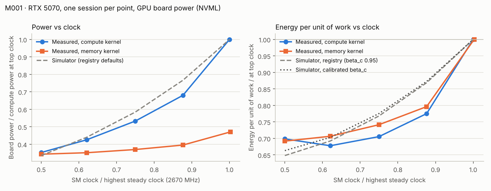
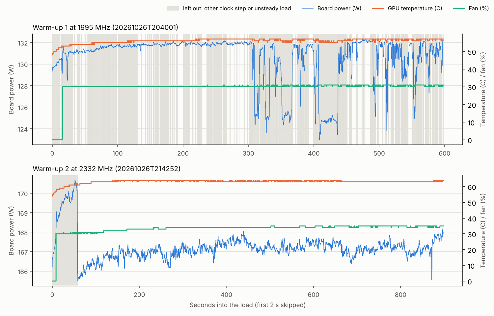

# 10 · Phase 4 calibration results: M001 and M002 (RTX 5070)

Generated by `python experiments/analyze_m001.py` from the raw sessions in `data/calibration/` and the vetted fit `data/calibration/M001_calibration.json` (SHA-256 `42112c3638fc2ad1…`). Do not edit by hand.

> **Provenance.** These are physical measurements (class B) on one GPU, one session per point. The boundary is **GPU board power as reported by NVML**: no host, PSU losses, or cooling plant. Comparisons with the simulator are shape comparisons (normalised to the highest clock), because the simulated accelerator is a 600 W-class device and this is a 250 W consumer card.

## Device and sessions

NVIDIA GeForce RTX 5070 (`GPU-91145432-3fb5-4033-dd9a-1e510e536d51`), NVML power limit 250 W, NVML clock-table maximum 3090 MHz. At default clocks the compute kernel ran at **2685 MHz and 250.0 W**, i.e. at the power limit. The highest steady clock in the sweep, 2670 MHz, is s = 1.

| Session | Locked (MHz) | Measured (MHz) | s | Board power (W) | Temp (C) | Throughput | Energy per unit of work |
|---|---|---|---|---|---|---|---|
| compute | 1342 | 1335 | 0.500 | 87.4 | 47 | 31.86 TFLOP/s | 2.7433 J/TFLOP |
| memory | 1342 | 1335 | 0.500 | 85.0 | 41 | 580.96 GB/s | 0.1464 J/GB |
| compute | 1680 | 1657 | 0.621 | 105.4 | 49 | 39.59 TFLOP/s | 2.6619 J/TFLOP |
| memory | 1680 | 1657 | 0.621 | 87.1 | 41 | 582.71 GB/s | 0.1495 J/GB |
| compute | 2017 | 2002 | 0.750 | 132.0 | 53 | 47.64 TFLOP/s | 2.7704 J/TFLOP |
| memory | 2017 | 2002 | 0.750 | 91.6 | 43 | 584.02 GB/s | 0.1569 J/GB |
| compute | 2347 | 2340 | 0.876 | 168.5 | 60 | 55.36 TFLOP/s | 3.0439 J/TFLOP |
| memory | 2347 | 2340 | 0.876 | 98.0 | 47 | 581.55 GB/s | 0.1685 J/GB |
| compute | 2685 | 2670 | 1.000 | 247.7 | 72 | 63.08 TFLOP/s | 3.9272 J/TFLOP |
| memory | 2685 | 2677 | 1.003 | 116.6 | 51 | 551.22 GB/s | 0.2116 J/GB |

Every locked clock held within 1.4% of the request. Throughput samples are medians over 50 s of steady load; the GPU was at 99–100% utilisation throughout.

## 1. Clock sensitivity: accepted

* **Compute kernel (FP16 matrix multiply): beta_compute = 0.983 ± 0.009** (95% CI). Throughput scales almost exactly with clock. The registry assumed 0.95.
* **Memory kernel (FP32 streaming update): measured -0.0557 ± 0.079**, consistent with zero: throughput stayed at 581–584 GB/s from 1335 to 2340 MHz and dipped to 551 GB/s at the top clock (one session). Transferred as **beta_memory = 0** under rule R3. The registry assumed 0.35 for LLM memory-bound phases. A pure streaming kernel is the extreme case; real decode traffic is not purely streaming, so 0 is a bound, not a measurement of decode.

## 2. Power and energy per unit of work vs clock (model-free)

| s | Measured power / top | Simulator power / top | Measured energy per work / top | Simulator (registry) | Simulator (calibrated beta_c) |
|---|---|---|---|---|---|
| 0.500 | 0.353 | 0.335 | 0.699 | 0.648 | 0.663 |
| 0.621 | 0.425 | 0.440 | 0.678 | 0.692 | 0.703 |
| 0.750 | 0.533 | 0.584 | 0.705 | 0.768 | 0.775 |
| 0.876 | 0.680 | 0.766 | 0.775 | 0.869 | 0.873 |
| 1.000 | 1.000 | 1.000 | 1.000 | 1.000 | 1.000 |

Simulator rows use registry defaults at the temperature measured in each session, with the compute kernel treated as activity 1.

**Finding A: energy per unit of work is lowest at a moderate clock.** For the compute kernel the minimum is at **1657 MHz (s = 0.62), 32% below the top clock**. It is nearly flat from s = 0.5 to 0.75 and rises steeply above that. For the memory kernel the minimum is at the lowest clock tested, **31% below the top clock with no loss of throughput**.

**Finding B: the simulator gets the size of the saving roughly right but the shape wrong.** With registry defaults it predicts the largest saving at the lowest clock (35%, measured 32% at the best clock). Near the top it underestimates: at s = 0.88 the measured saving is 22%, the simulator's 13%. Largest differences: power -0.086 and energy per work -0.094 of the top-clock value. Small clock cuts from the top save more than the simulator assumes; deep cuts save less.

Caveats: one session per point; temperature rose with clock (47 → 72 °C), so part of the top-end rise is leakage and fan; the top point ran at 99% of the power limit.

## 3. Voltage–frequency form: rejected

The registry form (voltage linear in clock between s = 0.5 and 1) was fitted to the five compute points. The fit ended at the edge of its range (v_min_ratio = 0.3) with R² 0.9927 and an rms residual of 4.8 W. Rule R1 rejects it: the measured curve is flat and then steep, which a linear voltage ramp cannot follow. The simulator keeps its placeholder v_min_ratio; Finding B quantifies the resulting error. Representing this curve properly needs a different voltage–frequency form, and a static and leakage measurement to separate dynamic power (section 4).

## 4. Leakage: not identified; its temperature slope is measured

Two warm-ups ran at a locked clock from an idle card. In both, the die heated by more than 10 K within the first seconds of load, the automatic fan then held the temperature almost flat, and the driver dropped one clock step (7–8 MHz) as the card warmed; in the second warm-up that step cut power by about 4 W. The second warm-up was meant to run with a fixed fan; the telemetry shows the fan under automatic control (0% at idle, 27–35% under load). Samples are kept only at one clock step and steady load; NVML reports temperature in whole degrees.

| Warm-up | Clock (MHz) | Board power (W) | Temperature kept | Fan | dP/dT, one clock step (W/K) | at constant fan (W/K) | Relative (%/K) | Simulator registry (%/K) |
|---|---|---|---|---|---|---|---|---|
| 1 (20261026T204001) | 1995 | 131 | 52–57 C | 0–31% | 0.182 ± 0.037 | 0.177 ± 0.039 (53–57 C) | 0.135 | 0.366 |
| 2 (20261026T214252) | 2332 | 167 | 61–64 C | 30–35% | 0.207 ± 0.014 | range < 2 K at constant fan | 0.124 (upper bound: fan rising) | 0.353 |

Neither warm-up spans enough temperature at constant clock, load and fan to separate leakage power from its temperature coefficient (the fit needs at least 8 K and in practice far more), so `kappa_leak` and `p_leak_ref` stay unmeasured (M001's stored leakage record used a looser clock rule; it was rejected either way, and M002 records the second attempt with the rule above).

**Finding C (two operating points, not transferred):** relative to total power, board power rises 0.12–0.13% per K on this card, 2.7–2.8× less than the simulator's registry at the same clock ratio and temperature. Each slope rests on a 3–5 K window on a consumer card, so this is evidence about the scale of temperature sensitivity, not a calibrated parameter.

**Why it matters.** In the sensitivity study (E002), joint control's advantage over independent control (-0.62% at registry values) almost vanished when leakage was made less temperature-sensitive: -0.04% with a third of the leakage power (p_leak_ref 30 W) and -0.03% with kappa_leak = 0.005/K. Running chips cooler to cut leakage is the mechanism that separates joint from independent control, so a real chip with a third of the assumed temperature sensitivity would leave little for joint control to gain. Pre-registered simulation E009 tests this directly with leakage matched to the measured slope.

**Further measurement** only helps with a fixed fan speed set in the card maker's tool (or a third-party fan utility), so the temperature can rise 20 K or more at constant fan power.

## 5. Driver limit flags

At every locked clock below 2.4 GHz the driver set the power-cap flag in 91–100% of compute samples while power was 35–68% of the limit and the locked clock held. At default clocks, when the card really sat at 250 W, it set no flag. On this GPU and driver the flag does not indicate a power limit; the tool now treats a flag as a limit only when the clock is not held or power is near the limit.

## 6. What goes into the simulator

| Parameter | Status | Value used in calibrated experiments |
|---|---|---|
| `beta_compute` | accepted | 0.983 |
| `beta_memory` | at physical limit | 0.0 |
| `v_min_ratio` | rejected: fit ended at the edge of its allowed range (v_min_ratio) | registry placeholder (0.7) |
| `kappa_leak` | rejected: fit ended at the edge of its allowed range (c_W) | registry placeholder (0.02) |
| `p_leak_ref` | rejected: derived from kappa_leak, which was rejected | registry placeholder (90.0) |

Calibrated experiment E001C re-runs the Phase 1 benchmark with the two accepted values. Its hypotheses were committed before it ran (`experiments/E001C_calibrated.json`).

## 7. Limitations

* One GPU, one session per clock, one compute and one memory kernel; no repeat sessions, so session-to-session variation is unknown.
* Board power only: host CPU, memory, PSU and cooling are outside the boundary.
* Temperature was not controlled between sessions; leakage and fan power differ from point to point.
* The kernels are synthetic. LLM prefill and decode mix compute and memory traffic.
* A consumer card is not a data-centre accelerator. Only dimensionless shapes are transferred.
