# UEIC · Simulation results (generated)

Generated 2026-11-02T03:16:05+00:00 by `python -m ueic report` from `results/ueic.sqlite`. Code SHA-256 `7f9f80817862e079…`. Hash-chain check: **OK** (8543 finalised runs verified).

> **Every number on this page is a simulator output** (provenance `simulator_output`) and is conditional on the parameter registry (`04_assumptions_register.md`), most of which is class E/F. E001C uses two parameters measured on a real GPU (M001); every other parameter is still a placeholder. The measurements themselves are reported in `10_calibration_results.md`. Energy boundary: grid → conversion → accelerators + pump + fans + chiller (see `00_problem_statement.md`).

## Pre-registered hypotheses, evaluated mechanically

| Experiment | Verdict | Detail |
|---|---|---|
| E001 H1 | **supported, small** | Joint below independent with CI under zero in 6/6 scenarios; beyond the 1% practical threshold in 2/6. |
| E001 H2 | **energy met, guard failed** | Every optimising policy below fixed on energy per successful task in every scenario; quality guard failed in 18 comparisons (slightly more late tasks). |
| E001C H1 | **supported** | With measured clock sensitivity, joint below independent with CI under zero in 6/6 scenarios; beyond the 1% threshold in 2/6. |
| E001C H2 | **energy met, guard failed** | Every optimising policy below fixed in every scenario; quality guard failed in 18 comparisons. |
| E001C HC1 | **supported** | Change in compute-only's saving vs fixed (calibrated minus E001, percentage points): moderate -4.14, high_load -6.10, hot -4.14, cool -4.14, memory_heavy -8.67, degraded_cooling -5.80; CI below zero in 6/6. |
| E001C HC2 | **supported** | Largest change in S5_memory_heavy (predicted S5_memory_heavy). |
| E001C HC3 | **supported** | Change in joint's advantage over independent (pp): moderate +0.08 [+0.03, +0.13], high_load +0.06 [+0.01, +0.12], hot -0.01 [-0.09, +0.06], cool +0.01 [-0.12, +0.15], memory_heavy +0.06 [+0.00, +0.13], degraded_cooling -0.15 [-0.30, +0.00]; within +/-0.5 pp in 6/6 (need 5). |
| E002 | **partly supported** | Joint never above independent in 50 one-at-a-time variants. Top driver of joint vs independent: p_leak_ref; of joint vs fixed: v_min_ratio; beta_memory ranks 6 (predicted top 2). |
| E003 | **partly supported** | Saves below break-even: yes; costs above it: yes; energy saving smaller than work saving: no; false accepts lower success: yes. |
| E004 | **not met** | Worst change dt 1 s vs 0.5 s: fixed 0.02%, joint 0.52% (criterion < 0.5%). |
| E005 | **partly supported** | Leakage/cold-plate twin errors pushed joint over the 80 °C target in 2/4 cases (S3_hot) and shrank its advantage over independent in 3/4; hardware protection held peak temperature near 85 °C. |
| E006 | **partly supported** | H1 joint < independent under both dynamic plants in all scenarios: yes. H2 joint over target with the slow plant: yes (S6_degraded_cooling). H3 fixed policy unaffected: yes. H4 joint_robust never worse than joint on overheating: no (S6_degraded_cooling/dyn_150kg_0.25Kmin, S6_degraded_cooling/dyn_40kg_1Kmin). |
| E007 | **supported, but suppression not the cause** | Switching cut by a 5% threshold: S1_moderate 16.5%, S3_hot 24.5% (H1 <25%: yes). Worst dt-sensitivity at 2%: S1_moderate 0.39%, S3_hot 0.38%; with no threshold: S1_moderate 0.39%, S3_hot 0.38%. Energy cost of 2%: <= 0.3%. |
| E008 | **partly supported** | Where joint overheated (2 cases) the correction cut chip-seconds over target by 85%, 84% with no throttling (H1: yes). Not confirmed no-worse than independent in S3_hot/high_leak|twin_low_leak (H2: no). Within 0.5% of joint with a correct twin (H3: yes). |
| E009 H1 | **supported** | Joint's advantage over independent smaller with matched leakage (kappa 0.02) than registry leakage, CI above zero in 6/6 scenarios. |
| E009 H2 | **supported** | Joint vs independent with matched leakage: moderate -0.10% [-0.12, -0.08], high_load -0.06% [-0.07, -0.04], hot -0.03% [-0.05, -0.01], cool -0.43% [-0.49, -0.38], memory_heavy -0.18% [-0.22, -0.15], degraded_cooling -0.23% [-0.29, -0.18]; inside +/-1% in 6/6 (registry: moderate -0.56%, high_load -0.98%, hot -0.32%, cool -1.44%, memory_heavy -0.50%, degraded_cooling -1.45%). |
| E009 H3 | **supported** | Inside +/-1% in all scenarios for: matched_k0.01, matched_k0.02, matched_k0.03, matched_k0.02_low, matched_k0.02_high. Not for: none. |
| E009 H4 | **supported** | Independent's chip-seconds over target fell with matched leakage in 2/2 scenarios where it had any. |
| E010 H1 | **supported** | Quasi-steady plant: joint throttled in 0/9 conditions and exceeded 80 C in 0/9. |
| E010 H2 | **supported** | Quasi-steady plant: independent throttled in 3/9 conditions: moderate|amb40|quasi, severe|amb30|quasi, severe|amb40|quasi; worst 246 chip-s throttled. |
| E010 H3 | **supported** | Dynamic loop, severe degradation: joint exceeded 80 C in severe|amb40|dyn40. |
| E010 H4 | **supported** | Joint vs independent energy -2.41% to -0.04%; CI upper bound below +1% in all 18 conditions. |
| E010 H5 | **supported** | Joint vs fixed energy -35.4% to -40.5%; at least 10% below fixed in every condition. |
| E011 H1 | **supported** | joint_lag throttled in 0/27 conditions. |
| E011 H2 | **supported** | Dynamic loops, chip-s above 80 C summed over 18 conditions (seed means): independent 10008, joint 17218, joint_lag 0; joint_lag above target in 0/18. |
| E011 H3 | **supported** | Quasi-steady plant: joint_lag's runs identical to joint's, seed by seed, in 9/9 conditions. |
| E011 H4 | **supported** | joint_lag vs joint energy -8.77% to +0.00%; not below +0.5% in 0, not below independent where it overheated in 0. |
| E011 H5 | **not supported** | joint_lag's late tasks more than 2 above the worse of joint and independent in 2/27 conditions: severe|amb40|dyn40, severe|amb40|dyn150. |
| E011B H1 | **supported** | joint_fb vs joint energy per successful task -4.74% to -4.50% over 27 conditions; CI upper bound not below -2% in 0. |
| E011B H2 | **supported** | joint_lag vs joint_fb in the 14 benign dynamic conditions +0.00% to +0.00%; CI outside +/-0.5% in 0. |
| E011B H3 | **supported** | Chip-s above 80 C where joint overheated in E011 (joint / joint_fb / joint_lag): moderate|amb40|dyn40 1473 / 1188 / 0; severe|amb40|dyn40 5493 / 4094 / 0; moderate|amb40|dyn150 1820 / 1432 / 0; severe|amb40|dyn150 8433 / 6155 / 0. |
| E011B H4 | **supported** | Late tasks per run in severe|amb40 (joint / joint_fb / joint_lag): dyn40 2.0 / 2.2 / 7.6; dyn150 2.0 / 2.6 / 7.6. |
| E011B H5 | **supported** | 270/270 joint and joint_lag runs compared with E011; 0 differ. |
| E012 H1 | **not supported** | joint_lag mean supply temperature, measured minus registry world, no floor: moderate/quasi +0.0 K, moderate/dyn150 +0.0 K, hot/quasi +0.0 K, hot/dyn150 -0.0 K, cool/quasi +0.0 K, cool/dyn150 +0.0 K (needed >= +10 K). |
| E012 H2 | **not supported** | Reusable share of rejected heat, joint_lag, no floor, quasi-steady (measured / registry): moderate 0% / 0%, cool 0% / 0%. |
| E012 H3 | **not supported** | Energy cost of the 40 C floor for joint_lag. Measured world: moderate/quasi +2.71%, moderate/dyn150 +2.74%, hot/quasi +0.00%, hot/dyn150 +0.00%, cool/quasi +4.43%, cool/dyn150 +4.48%. Registry world: moderate/quasi +7.70%, moderate/dyn150 +7.70%, hot/quasi +0.00%, hot/dyn150 +0.00%, cool/quasi +12.86%, cool/dyn150 +12.86%. Not below +0.5% (measured): S1_moderate/quasi, S1_moderate/dyn150, S4_cool/quasi, S4_cool/dyn150. Registry not costlier: S3_hot/quasi, S3_hot/dyn150. |
| E012 H4 | **supported** | joint_lag above 80 C in no condition. |
| E012 H5 | **not supported** | Steady-state joint above 80 C with the 150 kg loop in no condition. |
| E013 H1 | **supported** | joint_fb without margin above 80 C in 4/12 conditions (chip-s summed over conditions: 12868). |
| E013 H2 | **supported** | Chip-s above 80 C summed over conditions by margin: 0 K 12868, 3 K 8394, 6 K 10348, 9 K 7232; no margin tested was safe everywhere. |
| E013 H3 | **supported** | joint_lag vs joint_fb with a 9 K margin: energy -7.29% to +0.00%; cheaper (CI below 0) in 10/12 conditions (needed 9). |
| E013 H4 | **not supported** | joint_lag more than 1 late task above joint_fb (9 K margin) in 2 conditions: severe|amb40|dyn40, severe|amb40|dyn150. |
| E013 H5 | **supported** | joint_lag above 80 C in 0/12 conditions. |
| E014 H1 | **supported** | Exact-model joint_lag above 80 C in 0/6 conditions. |
| E014 H2 | **supported** | Chip-s above 80 C summed over conditions with a wrong loop model: mass_x0.25 0, mass_x4 0, ramp_x0.25 0, ramp_x4 0. |
| E014 H3 | **supported** | Model-free joint_meas: chip-s above 80 C summed 0, throttled 0. |
| E014 H4 | **supported** | joint_meas vs joint_lag energy +0.00% to +0.00%; outside +/-1% or late tasks off by > 1 in 0. |
| E014 H5 | **supported** | Wrong-model vs exact-model joint_lag energy +0.00% to +0.00%; CI outside +/-1% in 0. |
| E015 H1 | **supported** | MPC arms above 80 C in 0 condition-arms; conditions with any fallback decision: 0. |
| E015 H2 | **not supported** | Burst, slow loops, late tasks joint_meas -> mpc(oracle), energy: loop40|d0 1.2 -> 0.8, -0.50% (fails); loop40|d180 1.2 -> 0.8, -0.46% (fails); loop150|d0 1.2 -> 0.8, -3.06% (fails); loop150|d180 1.2 -> 0.8, -3.07% (fails). Passing: 0/4 (needed 3). |
| E015 H3 | **not supported** | Instant plant, no delay, late tasks joint_meas / mpc(oracle), energy: burst 1.2 / 0.8, -0.40% (fails); ambient_ramp 0.2 / 0.2, -1.54% (fails); overload 179.6 / 179.2, +0.52%; degraded 0.2 / 0.2, -3.23% (fails). |
| E015 H4 | **not supported** | Late tasks summed over the 4 slow-loop burst conditions: oracle 3.2, noisy 8.0, base 4.8, blind 56.0 (base = persistence). |
| E015 H5 | **supported** | Overload: arms with no late tasks 0; conditions where mpc(oracle) differs from joint_meas by > 15%: 0. |
| E015 H6 | **supported** | mpc_robust(oracle) less safe or > +3% energy vs mpc(oracle) in 0 conditions. |
| E016 H1 | **supported** | No-drift harm checks failing: none. |
| E016 H2 | **supported** | joint_fixed above 80 C in 4/6 drift conditions: slow|amb35, fast|amb25, fast|amb35, step|amb35. |
| E016 H3 | **not supported** | chip-s above 80 C, fixed/recal/adaptive: none|amb25 0/0/0; none|amb35 0/0/0; slow|amb25 0/0/0; slow|amb35 15/0/0; fast|amb25 49/15/0; fast|amb35 778/325/182; step|amb25 0/0/0; step|amb35 1444/1169/969. Adaptive not >= 80% lower in: fast|amb35, step|amb35. |
| E016 H4 | **not supported** | Adaptive not better than periodic after a step in: step|amb25. |
| E016 H5 | **not supported** | Peak-temperature MAE fixed/adaptive (K): slow|amb25 2.31/1.50; slow|amb35 2.36/1.54; fast|amb25 5.23/2.08; fast|amb35 5.27/2.07; step|amb25 4.46/2.02; step|amb35 4.54/2.03. |
| E016 H6 | **supported** | Adaptive > +2% energy where fixed was safe in none. |
| E016 H7 | **not supported** | Step conditions with a late or missed alarm: step|amb25, step|amb35; false alarms without drift: none|amb25, none|amb35. |
| E018 H1 | **not supported** | thermal_credit energy per on-time job vs baselines: C2: round_robin -14.4% [-34.3%, +5.6%], least_loaded +5.4% [-45.9%, +56.7%], power_aware +7.3% [-29.9%, +44.4%], temperature_aware +17.3% [-26.9%, +61.5%]; C3: round_robin -31.3% [-40.9%, -21.7%], least_loaded -14.4% [-53.5%, +24.8%], power_aware -13.4% [-24.9%, -1.9%], temperature_aware -4.6% [-27.9%, +18.6%]; C5: round_robin -26.5% [-42.7%, -10.2%], least_loaded -10.3% [-14.3%, -6.4%], power_aware -18.2% [-35.5%, -0.8%], temperature_aware -8.3% [-12.3%, -4.2%]. |
| E018 H2 | **supported** | chip-s above t_target: C1 TC/TA/LL 0/0/0; C2 TC/TA/LL 8757/28864/31721; C3 TC/TA/LL 20875/71800/83898; C4 TC/TA/LL 199/926/2581; C5 TC/TA/LL 13696/76815/84416. |
| E018 H3 | **not supported** | on-time fraction: C1 TC 1.000 best baseline 1.000; C2 TC 0.797 best baseline 0.954; C3 TC 0.868 best baseline 0.951; C4 TC 0.947 best baseline 0.963; C5 TC 0.953 best baseline 0.996. |
| E018 H4 | **supported** | C1 thermal_credit vs least_loaded energy -0.2%. |
| E018 H5 | **supported** | C4 on-time thermal_credit vs power_aware. |
| E019 H1 | **supported** | no-fault: no alarms and energy within 0.5%: joint_meas +0.00%; mpc +0.00%. |
| E019 H2 | **supported** | window faults detected within 180 s of onset in 85% of fault-aware runs (needed 80%). |
| E019 H3 | **supported** | chip-s above t_target nominal -> fault-aware (nonzero only): F4_clock_stuck|joint_meas: 103 -> 15; F4_clock_stuck|mpc: 245 -> 27; F8_supply_bias_low|mpc: 193 -> 67; P2_fouling_step|joint_meas: 1068 -> 224; P2_fouling_step|mpc: 1436 -> 266; P3_pump_degraded|joint_meas: 605 -> 605; P3_pump_degraded|mpc: 389 -> 353; P4_wrong_model|joint_meas: 398 -> 0; P4_wrong_model|mpc: 709 -> 0. |
| E019 H4 | **supported** | clock stuck, aware/nominal chip-s: joint_meas 15/103; mpc 27/245. |
| E019 H5 | **supported** | back to NORMAL within 300 s after the window in 94% of runs that left NORMAL. |
| E019 H6 | **not supported** | degradation alarm in 70% of fault-aware runs with fouling, a degraded pump or a wrong model. |
| E020 H1 | **not supported** | joint vs independent, energy per on-time job: n16|amb20: +16.4% [-10.0%, +42.9%]; n16|amb30: +8.4% [-15.8%, +32.7%]; n1|amb20: -7.3% [-14.2%, -0.5%]; n1|amb30: -16.4% [-23.7%, -9.1%]; n4|amb20: +22.0% [-35.0%, +79.0%]; n4|amb30: +11.1% [-42.4%, +64.7%]. |
| E020 H2 | **not supported** | on-time fraction joint vs independent: n16|amb20: 0.475 vs 0.615; n16|amb30: 0.475 vs 0.615; n1|amb20: 0.919 vs 0.972; n1|amb30: 0.919 vs 0.972; n4|amb20: 0.823 vs 0.995; n4|amb30: 0.823 vs 0.995. |
| E020 H3 | **not supported** | benefit at 16 nodes vs 1 node (see H1 values). |
| E020 H4 | **not supported** | 16 nodes, heat-proportional valves vs equal: amb20: +2.8% [-2.5%, +8.1%]; amb30: +1.8% [-3.3%, +6.8%]. |
| E021 H1 | **not supported** | Mean supply NTU minus legacy, no floor: registry/8 C -0.8 K; registry/20 C -1.9 K; registry/30 C -1.9 K; rtx5070/8 C -0.8 K; rtx5070/20 C -1.3 K; rtx5070/30 C -1.4 K. |
| E021 H2 | **supported** | Mean supply with the NTU plant, no floor: registry/8 C 12.2 C; registry/20 C 23.1 C; rtx5070/8 C 12.2 C; rtx5070/20 C 23.7 C. |
| E021 H3 | **not supported** | Warming RTX vs registry world: 8 C -0.8 vs -0.8 K; 20 C -1.3 vs -1.9 K. |
| E021 H4 | **not supported** | 40 C floor cost NTU vs legacy: registry/8 C 12.77% vs 12.86%; registry/20 C 7.81% vs 7.70%; rtx5070/8 C 4.41% vs 4.48%; rtx5070/20 C 2.71% vs 2.74%. |
| E021 H5 | **supported** | Mean supply fan 0.04 / 0.02 / 0.01: registry/8 C 12.4/12.2/12.0; registry/20 C 23.9/23.1/22.6; rtx5070/8 C 12.8/12.2/12.0; rtx5070/20 C 24.6/23.7/23.0. |
| E021 H6 | **supported** | RTX world, 44 C floor: kWh_el per kWh_th of reusable heat gained: ntu/8 C 0.054; ntu/20 C 0.037; legacy/8 C 0.055; legacy/20 C 0.038 (needed < 0.10). |
| E021 H7 | **supported** | Warm loop vs heat pump (kWh_el per kWh_th): ntu/8 C 0.054 vs 0.226; ntu/20 C 0.037 vs 0.154; legacy/8 C 0.055 vs 0.221; legacy/20 C 0.038 vs 0.147. |
| E022 H1 | **supported** | cap: energy above cap / event energy (kWh): amb20 0.000/7.343; amb30 0.000/7.438. |
| E022 H2 | **supported** | on-time fraction cap_defer vs cap: amb20 0.983 vs 0.972; amb30 0.983 vs 0.969. |
| E022 H3 | **not supported** | work during the event, storage vs cap: 30 C +0.7% [-0.8%, +2.1%]; 20 C -0.0%. |
| E022 H4 | **not supported** | 30 C energy cap_storage/cap 39.395/40.068 kWh; cost 8.352/8.637. |
| E022 H5 | **supported** | uncapped arm exceeds the cap in every seed: amb20 1.051 kWh above; amb30 1.894 kWh above. |
| E024 H1 | **not supported** | full vs baseline energy per on-time job +13.6% [-14.4%, +41.7%]. |
| E024 H2 | **not supported** | leave-one-out vs full: without S -37.3%; without V -5.2%; without T -7.0%; without D +0.0%. |
| E024 H3 | **not supported** | on-time fraction full 0.4702922643320354 vs baseline 0.6175853781800177. |
| E024 H4 | **not supported** | chip-s above target full 1159.2 vs baseline 0.0. |

## E004 · Time-step convergence

Experiment `E004-20261026T180548-d4faa6`. Pre-registered criterion: grid energy changes < 0.5% between dt = 0.5 s and 1 s.

| Policy | Seed | dt | Change in grid energy vs dt = 0.5 s |
|---|---|---|---|
| fixed | 0 | dt=0.25 | -0.008% |
| fixed | 0 | dt=1.0 | -0.020% |
| fixed | 0 | dt=2.0 | -0.019% |
| fixed | 1 | dt=0.25 | +0.002% |
| fixed | 1 | dt=1.0 | -0.004% |
| fixed | 1 | dt=2.0 | -0.018% |
| joint | 0 | dt=0.25 | +0.375% |
| joint | 0 | dt=1.0 | +0.345% |
| joint | 0 | dt=2.0 | +0.596% |
| joint | 1 | dt=0.25 | -0.064% |
| joint | 1 | dt=1.0 | +0.524% |
| joint | 1 | dt=2.0 | +1.510% |

Worst |change| at dt = 1 s: fixed 0.020%, joint 0.524%. **Criterion NOT met.**

## E001 · Policy benchmark

Experiment `E001-20261026T181652-ada586`: 300 runs, 0 failed. 6 scenarios × 5 policies × 10 paired seeds.

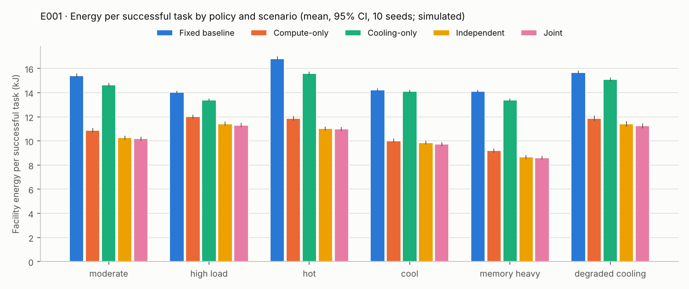

### Energy per successful task (kJ, mean [95% CI])

| Scenario | Fixed baseline | Compute-only | Cooling-only | Independent | Joint |
|---|---|---|---|---|---|
| S1_moderate | 15.42 [15.27, 15.58] | 10.88 [10.70, 11.06] | 14.66 [14.51, 14.81] | 10.26 [10.09, 10.43] | 10.19 [10.02, 10.36] |
| S2_high_load | 14.05 [13.95, 14.14] | 12.02 [11.85, 12.19] | 13.41 [13.31, 13.50] | 11.43 [11.26, 11.60] | 11.31 [11.15, 11.47] |
| S3_hot | 16.82 [16.65, 16.99] | 11.86 [11.67, 12.06] | 15.59 [15.44, 15.75] | 11.02 [10.84, 11.20] | 10.98 [10.80, 11.16] |
| S4_cool | 14.21 [14.07, 14.36] | 10.02 [9.86, 10.19] | 14.10 [13.96, 14.24] | 9.86 [9.70, 10.02] | 9.73 [9.56, 9.89] |
| S5_memory_heavy | 14.10 [13.98, 14.23] | 9.20 [9.03, 9.36] | 13.39 [13.27, 13.50] | 8.66 [8.50, 8.82] | 8.61 [8.45, 8.77] |
| S6_degraded_cooling | 15.69 [15.54, 15.84] | 11.88 [11.65, 12.10] | 15.10 [14.96, 15.24] | 11.41 [11.19, 11.63] | 11.25 [11.04, 11.47] |

### Paired comparisons of energy per successful task

Practical threshold ±1%. Δ SLO = change in late-or-unfinished tasks per run (mean); Δ throttled = change in chip-seconds under hardware throttling.

| Scenario | Comparison | Change [95% CI] | Verdict | Δ SLO | Δ success rate | Δ throttled |
|---|---|---|---|---|---|---|
| S1_moderate | Compute-only vs Fixed baseline | -29.48% [-30.11%, -28.86%] | meaningful reduction (CI beyond threshold) | +0.2 | -0.007 pp | +0 |
| S2_high_load | Compute-only vs Fixed baseline | -14.44% [-15.46%, -13.42%] | meaningful reduction (CI beyond threshold) | +1.8 | -0.041 pp | +0 |
| S3_hot | Compute-only vs Fixed baseline | -29.47% [-30.10%, -28.85%] | meaningful reduction (CI beyond threshold) | +0.2 | -0.007 pp | +0 |
| S4_cool | Compute-only vs Fixed baseline | -29.49% [-30.11%, -28.86%] | meaningful reduction (CI beyond threshold) | +0.2 | -0.007 pp | +0 |
| S5_memory_heavy | Compute-only vs Fixed baseline | -34.78% [-35.57%, -34.00%] | meaningful reduction (CI beyond threshold) | +0.2 | -0.007 pp | +0 |
| S6_degraded_cooling | Compute-only vs Fixed baseline | -24.30% [-25.26%, -23.35%] | meaningful reduction (CI beyond threshold) | +0.5 | -0.013 pp | +0 |
| S1_moderate | Cooling-only vs Fixed baseline | -4.97% [-4.99%, -4.95%] | meaningful reduction (CI beyond threshold) | +0.0 | +0.000 pp | +0 |
| S2_high_load | Cooling-only vs Fixed baseline | -4.57% [-4.59%, -4.55%] | meaningful reduction (CI beyond threshold) | +0.0 | +0.000 pp | +0 |
| S3_hot | Cooling-only vs Fixed baseline | -7.28% [-7.30%, -7.26%] | meaningful reduction (CI beyond threshold) | +0.0 | +0.000 pp | +0 |
| S4_cool | Cooling-only vs Fixed baseline | -0.82% [-0.91%, -0.73%] | detectable reduction, not confirmed >= threshold | +0.0 | +0.000 pp | +0 |
| S5_memory_heavy | Cooling-only vs Fixed baseline | -5.09% [-5.11%, -5.07%] | meaningful reduction (CI beyond threshold) | +0.0 | +0.000 pp | +0 |
| S6_degraded_cooling | Cooling-only vs Fixed baseline | -3.77% [-3.82%, -3.72%] | meaningful reduction (CI beyond threshold) | +0.0 | +0.000 pp | +0 |
| S1_moderate | Independent vs Fixed baseline | -33.49% [-34.09%, -32.88%] | meaningful reduction (CI beyond threshold) | +0.2 | -0.007 pp | +0 |
| S2_high_load | Independent vs Fixed baseline | -18.64% [-19.64%, -17.63%] | meaningful reduction (CI beyond threshold) | +1.8 | -0.041 pp | +0 |
| S3_hot | Independent vs Fixed baseline | -34.50% [-35.06%, -33.94%] | meaningful reduction (CI beyond threshold) | +0.2 | -0.007 pp | +10 |
| S4_cool | Independent vs Fixed baseline | -30.63% [-31.23%, -30.02%] | meaningful reduction (CI beyond threshold) | +0.2 | -0.007 pp | +0 |
| S5_memory_heavy | Independent vs Fixed baseline | -38.60% [-39.37%, -37.83%] | meaningful reduction (CI beyond threshold) | +0.2 | -0.007 pp | +0 |
| S6_degraded_cooling | Independent vs Fixed baseline | -27.28% [-28.23%, -26.34%] | meaningful reduction (CI beyond threshold) | +0.5 | -0.013 pp | +188 |
| S1_moderate | Joint vs Fixed baseline | -33.92% [-34.53%, -33.31%] | meaningful reduction (CI beyond threshold) | +0.2 | -0.007 pp | +0 |
| S2_high_load | Joint vs Fixed baseline | -19.48% [-20.44%, -18.52%] | meaningful reduction (CI beyond threshold) | +1.8 | -0.041 pp | +0 |
| S3_hot | Joint vs Fixed baseline | -34.72% [-35.28%, -34.15%] | meaningful reduction (CI beyond threshold) | +0.2 | -0.007 pp | +0 |
| S4_cool | Joint vs Fixed baseline | -31.57% [-32.22%, -30.91%] | meaningful reduction (CI beyond threshold) | +0.2 | -0.007 pp | +0 |
| S5_memory_heavy | Joint vs Fixed baseline | -38.96% [-39.72%, -38.20%] | meaningful reduction (CI beyond threshold) | +0.2 | -0.007 pp | +0 |
| S6_degraded_cooling | Joint vs Fixed baseline | -28.27% [-29.22%, -27.33%] | meaningful reduction (CI beyond threshold) | +0.5 | -0.013 pp | +0 |
| S1_moderate | Joint vs Independent | -0.65% [-0.68%, -0.63%] | detectable reduction, not confirmed >= threshold | +0.0 | +0.000 pp | +0 |
| S2_high_load | Joint vs Independent | -1.04% [-1.11%, -0.97%] | detectable reduction, not confirmed >= threshold | +0.0 | +0.000 pp | +0 |
| S3_hot | Joint vs Independent | -0.33% [-0.37%, -0.29%] | detectable reduction, not confirmed >= threshold | +0.0 | +0.000 pp | -10 |
| S4_cool | Joint vs Independent | -1.36% [-1.49%, -1.22%] | meaningful reduction (CI beyond threshold) | +0.0 | +0.000 pp | +0 |
| S5_memory_heavy | Joint vs Independent | -0.58% [-0.65%, -0.51%] | detectable reduction, not confirmed >= threshold | +0.0 | +0.000 pp | +0 |
| S6_degraded_cooling | Joint vs Independent | -1.36% [-1.50%, -1.22%] | meaningful reduction (CI beyond threshold) | +0.0 | +0.000 pp | -188 |
| S1_moderate | Joint vs Compute-only | -6.30% [-6.34%, -6.26%] | meaningful reduction (CI beyond threshold) | +0.0 | +0.000 pp | +0 |
| S2_high_load | Joint vs Compute-only | -5.89% [-5.94%, -5.84%] | meaningful reduction (CI beyond threshold) | +0.0 | +0.000 pp | +0 |
| S3_hot | Joint vs Compute-only | -7.43% [-7.45%, -7.41%] | meaningful reduction (CI beyond threshold) | +0.0 | +0.000 pp | +0 |
| S4_cool | Joint vs Compute-only | -2.95% [-3.03%, -2.88%] | meaningful reduction (CI beyond threshold) | +0.0 | +0.000 pp | +0 |
| S5_memory_heavy | Joint vs Compute-only | -6.40% [-6.45%, -6.35%] | meaningful reduction (CI beyond threshold) | +0.0 | +0.000 pp | +0 |
| S6_degraded_cooling | Joint vs Compute-only | -5.25% [-5.33%, -5.16%] | meaningful reduction (CI beyond threshold) | +0.0 | +0.000 pp | +0 |
| S1_moderate | Joint vs Cooling-only | -30.47% [-31.10%, -29.84%] | meaningful reduction (CI beyond threshold) | +0.2 | -0.007 pp | +0 |
| S2_high_load | Joint vs Cooling-only | -15.63% [-16.61%, -14.64%] | meaningful reduction (CI beyond threshold) | +1.8 | -0.041 pp | +0 |
| S3_hot | Joint vs Cooling-only | -29.59% [-30.21%, -28.97%] | meaningful reduction (CI beyond threshold) | +0.2 | -0.007 pp | +0 |
| S4_cool | Joint vs Cooling-only | -31.00% [-31.64%, -30.36%] | meaningful reduction (CI beyond threshold) | +0.2 | -0.007 pp | +0 |
| S5_memory_heavy | Joint vs Cooling-only | -35.68% [-36.47%, -34.90%] | meaningful reduction (CI beyond threshold) | +0.2 | -0.007 pp | +0 |
| S6_degraded_cooling | Joint vs Cooling-only | -25.47% [-26.47%, -24.46%] | meaningful reduction (CI beyond threshold) | +0.5 | -0.013 pp | +0 |
| S1_moderate | Independent vs Compute-only | -5.68% [-5.71%, -5.65%] | meaningful reduction (CI beyond threshold) | +0.0 | +0.000 pp | +0 |
| S2_high_load | Independent vs Compute-only | -4.90% [-4.95%, -4.86%] | meaningful reduction (CI beyond threshold) | +0.0 | +0.000 pp | +0 |
| S3_hot | Independent vs Compute-only | -7.13% [-7.17%, -7.08%] | meaningful reduction (CI beyond threshold) | +0.0 | +0.000 pp | +10 |
| S4_cool | Independent vs Compute-only | -1.62% [-1.71%, -1.52%] | meaningful reduction (CI beyond threshold) | +0.0 | +0.000 pp | +0 |
| S5_memory_heavy | Independent vs Compute-only | -5.85% [-5.91%, -5.79%] | meaningful reduction (CI beyond threshold) | +0.0 | +0.000 pp | +0 |
| S6_degraded_cooling | Independent vs Compute-only | -3.94% [-4.03%, -3.84%] | meaningful reduction (CI beyond threshold) | +0.0 | +0.000 pp | +188 |

### Hypotheses

* **H1** (joint < independent with CI below zero in ≥ 4 of 6 scenarios, guards held): **supported**. CI below zero in 6/6 (S1_moderate, S2_high_load, S3_hot, S4_cool, S5_memory_heavy, S6_degraded_cooling); beyond the 1% practical threshold in 2/6 (S4_cool, S6_degraded_cooling).
* **H2** (every optimising policy below fixed in every scenario): energy criterion **met**; pre-registered quality guard **failed in 18 of 24 comparisons** (SLO violations or success rate slightly worse than fixed; see table). Formally, H2 is therefore **not supported as pre-registered**.

### Thermal and quality guards by policy (means over seeds)

| Scenario | Policy | Success rate | SLO violations | p95 latency (s) | Peak T_j (°C) | chip·s > 80 °C | chip·s throttled | Reusable heat ≥45 °C (kWh) |
|---|---|---|---|---|---|---|---|---|
| S1_moderate | Fixed baseline | 0.9708 | 0.0 | 47.2 | 52.0 | 0 | 0 | 0.00 |
| S1_moderate | Compute-only | 0.9708 | 0.2 | 68.9 | 51.9 | 0 | 0 | 0.00 |
| S1_moderate | Cooling-only | 0.9708 | 0.0 | 47.2 | 71.2 | 0 | 0 | 0.00 |
| S1_moderate | Independent | 0.9708 | 0.2 | 68.9 | 69.4 | 0 | 0 | 0.00 |
| S1_moderate | Joint | 0.9708 | 0.2 | 68.9 | 61.5 | 0 | 0 | 0.00 |
| S2_high_load | Fixed baseline | 0.9685 | 2.8 | 56.0 | 52.0 | 0 | 0 | 0.00 |
| S2_high_load | Compute-only | 0.9681 | 4.6 | 64.9 | 52.0 | 0 | 0 | 0.00 |
| S2_high_load | Cooling-only | 0.9685 | 2.8 | 56.0 | 69.8 | 0 | 0 | 0.00 |
| S2_high_load | Independent | 0.9681 | 4.6 | 64.9 | 69.6 | 0 | 0 | 0.00 |
| S2_high_load | Joint | 0.9681 | 4.6 | 65.0 | 61.8 | 0 | 0 | 0.00 |
| S3_hot | Fixed baseline | 0.9708 | 0.0 | 47.2 | 52.0 | 0 | 0 | 0.00 |
| S3_hot | Compute-only | 0.9708 | 0.2 | 68.9 | 51.9 | 0 | 0 | 0.00 |
| S3_hot | Cooling-only | 0.9708 | 0.0 | 47.2 | 79.8 | 4 | 0 | 6.14 |
| S3_hot | Independent | 0.9708 | 0.2 | 68.9 | 85.1 | 425 | 10 | 3.54 |
| S3_hot | Joint | 0.9708 | 0.2 | 68.9 | 76.6 | 0 | 0 | 2.10 |
| S4_cool | Fixed baseline | 0.9708 | 0.0 | 47.2 | 52.0 | 0 | 0 | 0.00 |
| S4_cool | Compute-only | 0.9708 | 0.2 | 68.9 | 51.9 | 0 | 0 | 0.00 |
| S4_cool | Cooling-only | 0.9708 | 0.0 | 47.2 | 71.2 | 0 | 0 | 0.00 |
| S4_cool | Independent | 0.9708 | 0.2 | 68.9 | 68.0 | 0 | 0 | 0.00 |
| S4_cool | Joint | 0.9708 | 0.2 | 68.9 | 49.4 | 0 | 0 | 0.00 |
| S5_memory_heavy | Fixed baseline | 0.9708 | 0.0 | 47.2 | 51.9 | 0 | 0 | 0.00 |
| S5_memory_heavy | Compute-only | 0.9708 | 0.2 | 63.3 | 51.8 | 0 | 0 | 0.00 |
| S5_memory_heavy | Cooling-only | 0.9708 | 0.0 | 47.2 | 70.2 | 0 | 0 | 0.00 |
| S5_memory_heavy | Independent | 0.9708 | 0.2 | 63.3 | 69.3 | 0 | 0 | 0.00 |
| S5_memory_heavy | Joint | 0.9708 | 0.2 | 63.4 | 62.3 | 0 | 0 | 0.00 |
| S6_degraded_cooling | Fixed baseline | 0.9705 | 0.6 | 51.3 | 69.7 | 0 | 0 | 0.00 |
| S6_degraded_cooling | Compute-only | 0.9704 | 1.1 | 67.0 | 69.6 | 0 | 0 | 0.00 |
| S6_degraded_cooling | Cooling-only | 0.9705 | 0.6 | 51.3 | 80.0 | 4 | 0 | 0.00 |
| S6_degraded_cooling | Independent | 0.9704 | 1.1 | 67.1 | 85.5 | 1240 | 188 | 0.00 |
| S6_degraded_cooling | Joint | 0.9704 | 1.1 | 67.1 | 78.9 | 0 | 0 | 0.00 |

### Energy breakdown (kWh per run, means)

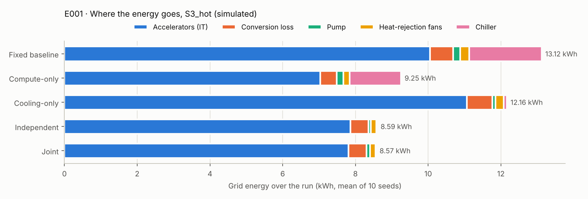

| Scenario | Policy | Grid | IT | Conversion | Pump | Fans | Chiller | Grid/IT |
|---|---|---|---|---|---|---|---|---|
| S1_moderate | Fixed baseline | 12.031 | 10.050 | 0.641 | 0.192 | 0.223 | 0.924 | 1.197 |
| S1_moderate | Compute-only | 8.485 | 7.033 | 0.449 | 0.193 | 0.158 | 0.653 | 1.206 |
| S1_moderate | Cooling-only | 11.433 | 10.523 | 0.672 | 0.028 | 0.211 | 0.000 | 1.086 |
| S1_moderate | Independent | 8.003 | 7.358 | 0.470 | 0.028 | 0.148 | 0.000 | 1.088 |
| S1_moderate | Joint | 7.950 | 7.274 | 0.464 | 0.065 | 0.147 | 0.000 | 1.093 |
| S2_high_load | Fixed baseline | 16.396 | 13.762 | 0.878 | 0.193 | 0.304 | 1.259 | 1.191 |
| S2_high_load | Compute-only | 14.026 | 11.745 | 0.750 | 0.193 | 0.260 | 1.078 | 1.194 |
| S2_high_load | Cooling-only | 15.647 | 14.411 | 0.920 | 0.028 | 0.289 | 0.000 | 1.086 |
| S2_high_load | Independent | 13.338 | 12.280 | 0.784 | 0.028 | 0.246 | 0.000 | 1.086 |
| S2_high_load | Joint | 13.200 | 12.050 | 0.769 | 0.137 | 0.244 | 0.000 | 1.095 |
| S3_hot | Fixed baseline | 13.119 | 10.050 | 0.641 | 0.192 | 0.245 | 1.991 | 1.305 |
| S3_hot | Compute-only | 9.253 | 7.033 | 0.449 | 0.193 | 0.173 | 1.406 | 1.316 |
| S3_hot | Cooling-only | 12.164 | 11.061 | 0.706 | 0.086 | 0.224 | 0.086 | 1.100 |
| S3_hot | Independent | 8.593 | 7.863 | 0.502 | 0.054 | 0.158 | 0.016 | 1.093 |
| S3_hot | Joint | 8.565 | 7.809 | 0.498 | 0.092 | 0.158 | 0.008 | 1.097 |
| S4_cool | Fixed baseline | 11.088 | 10.050 | 0.641 | 0.192 | 0.205 | 0.000 | 1.103 |
| S4_cool | Compute-only | 7.819 | 7.033 | 0.449 | 0.193 | 0.145 | 0.000 | 1.112 |
| S4_cool | Cooling-only | 10.997 | 10.120 | 0.646 | 0.028 | 0.203 | 0.000 | 1.087 |
| S4_cool | Independent | 7.692 | 7.071 | 0.451 | 0.028 | 0.143 | 0.000 | 1.088 |
| S4_cool | Joint | 7.588 | 6.950 | 0.444 | 0.054 | 0.140 | 0.000 | 1.092 |
| S5_memory_heavy | Fixed baseline | 11.003 | 9.175 | 0.586 | 0.192 | 0.204 | 0.846 | 1.199 |
| S5_memory_heavy | Compute-only | 7.176 | 5.920 | 0.378 | 0.193 | 0.133 | 0.552 | 1.212 |
| S5_memory_heavy | Cooling-only | 10.443 | 9.609 | 0.613 | 0.028 | 0.193 | 0.000 | 1.087 |
| S5_memory_heavy | Independent | 6.757 | 6.208 | 0.396 | 0.028 | 0.125 | 0.000 | 1.088 |
| S5_memory_heavy | Joint | 6.717 | 6.148 | 0.392 | 0.053 | 0.124 | 0.000 | 1.093 |
| S6_degraded_cooling | Fixed baseline | 15.935 | 12.747 | 0.814 | 0.192 | 0.296 | 1.886 | 1.250 |
| S6_degraded_cooling | Compute-only | 12.063 | 9.604 | 0.613 | 0.193 | 0.225 | 1.428 | 1.256 |
| S6_degraded_cooling | Cooling-only | 15.335 | 13.308 | 0.849 | 0.589 | 0.284 | 0.304 | 1.152 |
| S6_degraded_cooling | Independent | 11.588 | 10.205 | 0.651 | 0.305 | 0.214 | 0.213 | 1.136 |
| S6_degraded_cooling | Joint | 11.430 | 10.211 | 0.652 | 0.253 | 0.211 | 0.103 | 1.119 |

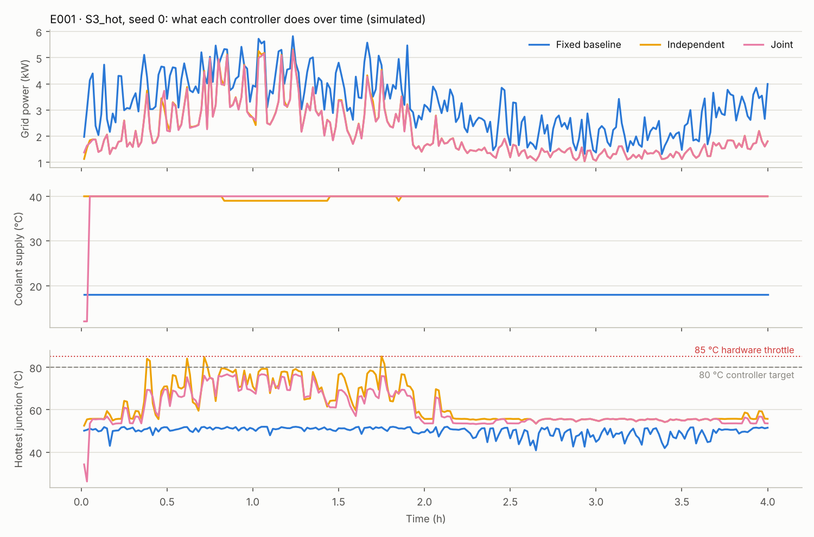

Controller overhead (measured wall-clock on the simulation host, not modelled energy): joint 0.99 ms per decision, independent 0.22 ms.

## E002 · One-at-a-time sensitivity

Experiment `E002-20261026T181319-d3c503`: 459 runs, 0 failed. S1, 2 h window, 3 seeds per cell (CIs are wide; use for ranking).

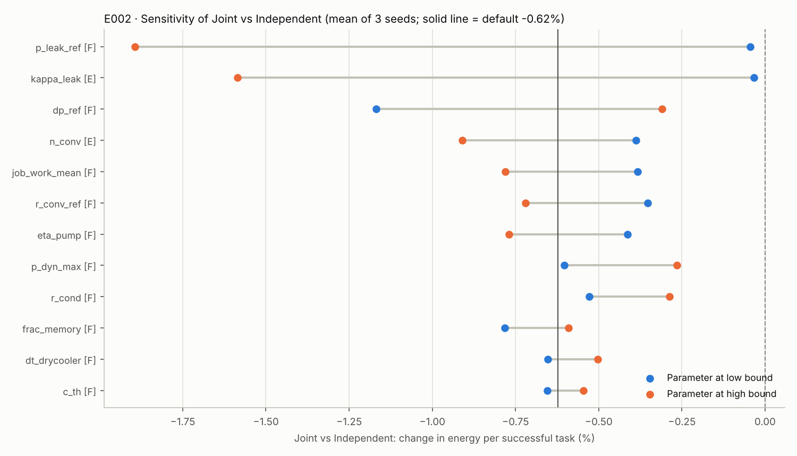

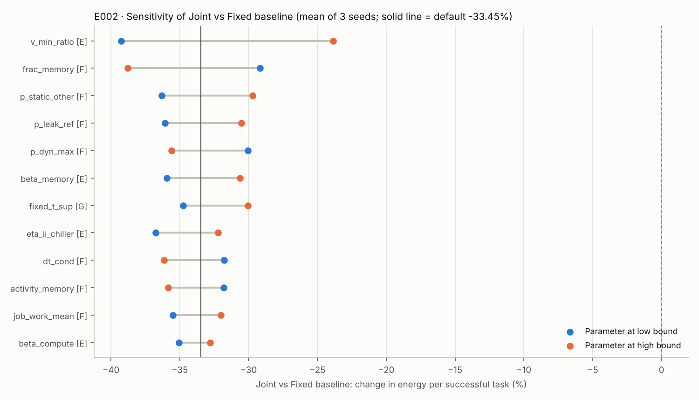

### Joint vs Independent (default -0.62%)

| Rank | Parameter | Class | Range | At low | At high | Swing |
|---|---|---|---|---|---|---|
| 1 | `p_leak_ref` | F | 30 – 180 W | -0.04% | -1.89% | 1.85 pp |
| 2 | `kappa_leak` | E | 0.005 – 0.04 1/K | -0.03% | -1.58% | 1.55 pp |
| 3 | `dp_ref` | F | 50000 – 300000 Pa | -1.17% | -0.31% | 0.86 pp |
| 4 | `n_conv` | E | 0.33 – 0.8 - | -0.39% | -0.91% | 0.52 pp |
| 5 | `job_work_mean` | F | 5 – 120 s | -0.38% | -0.78% | 0.40 pp |
| 6 | `r_conv_ref` | F | 0.008 – 0.03 K/W | -0.35% | -0.72% | 0.37 pp |
| 7 | `eta_pump` | F | 0.3 – 0.7 - | -0.41% | -0.77% | 0.36 pp |
| 8 | `p_dyn_max` | F | 300 – 700 W | -0.60% | -0.27% | 0.34 pp |
| 9 | `r_cond` | F | 0.02 – 0.06 K/W | -0.53% | -0.29% | 0.24 pp |
| 10 | `frac_memory` | F | 0.1 – 0.8 - | -0.78% | -0.59% | 0.19 pp |
| 11 | `dt_drycooler` | F | 3 – 10 K | -0.65% | -0.50% | 0.15 pp |
| 12 | `c_th` | F | 100 – 1000 J/K | -0.65% | -0.55% | 0.11 pp |
| 13 | `activity_memory` | F | 0.5 – 1 - | -0.71% | -0.78% | 0.08 pp |
| 14 | `beta_compute` | E | 0.85 – 1 - | -0.66% | -0.73% | 0.07 pp |
| 15 | `idle_dyn_frac` | F | 0 – 0.15 - | -0.65% | -0.58% | 0.07 pp |

### Joint vs Fixed baseline (default -33.45%)

| Rank | Parameter | Class | Range | At low | At high | Swing |
|---|---|---|---|---|---|---|
| 1 | `v_min_ratio` | E | 0.6 – 0.85 - | -39.26% | -23.87% | 15.39 pp |
| 2 | `frac_memory` | F | 0.1 – 0.8 - | -29.18% | -38.80% | 9.63 pp |
| 3 | `p_static_other` | F | 20 – 100 W | -36.30% | -29.72% | 6.58 pp |
| 4 | `p_leak_ref` | F | 30 – 180 W | -36.07% | -30.51% | 5.56 pp |
| 5 | `p_dyn_max` | F | 300 – 700 W | -30.04% | -35.59% | 5.55 pp |
| 6 | `beta_memory` | E | 0.15 – 0.6 - | -35.94% | -30.63% | 5.31 pp |
| 7 | `fixed_t_sup` | G | 12 – 27 degC | -34.75% | -30.05% | 4.70 pp |
| 8 | `eta_ii_chiller` | E | 0.3 – 0.65 - | -36.76% | -32.20% | 4.55 pp |
| 9 | `dt_cond` | F | 4 – 15 K | -31.78% | -36.15% | 4.37 pp |
| 10 | `activity_memory` | F | 0.5 – 1 - | -31.80% | -35.83% | 4.03 pp |
| 11 | `job_work_mean` | F | 5 – 120 s | -35.51% | -32.00% | 3.51 pp |
| 12 | `beta_compute` | E | 0.85 – 1 - | -35.06% | -32.78% | 2.28 pp |
| 13 | `dt_evap` | F | 1 – 6 K | -32.61% | -34.70% | 2.09 pp |
| 14 | `dt_drycooler` | F | 3 – 10 K | -33.78% | -31.92% | 1.86 pp |
| 15 | `dp_ref` | F | 50000 – 300000 Pa | -33.20% | -34.19% | 0.98 pp |

Variants where joint used **more** energy than independent (mean): none. With CI entirely above zero: none.

Variants in which any policy triggered hardware throttling: p_dyn_max=high, r_cond=high.

## E003 · Model-routing cascade

Experiment `E003-20261026T180946-28dd48`: 140 runs, 0 failed. **Quality model is a hypothetical placeholder (class F)**; the transferable results are the break-even condition and the work-vs-energy gap.

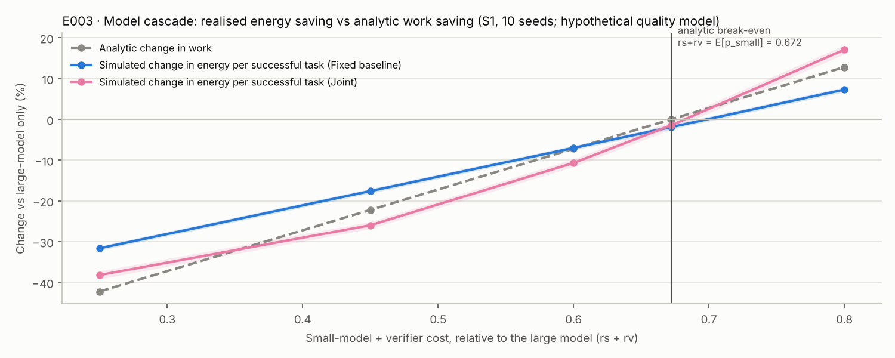

| Variant | Policy | rs+rv | Analytic Δ work | Simulated Δ work [CI] | Δ energy per success [CI] | Verdict | Δ success rate | Δ p95 latency |
|---|---|---|---|---|---|---|---|---|
| rs+rv=0.25 | Fixed baseline | 0.25 | -42.2% | -42.2% [-42.9%, -41.6%] | -31.6% [-32.2%, -31.0%] | meaningful reduction (CI beyond threshold) | +1.89 pp | -16.1% |
| rs+rv=0.25 | Joint | 0.25 | -42.2% | -42.2% [-42.9%, -41.6%] | -38.2% [-39.1%, -37.2%] | meaningful reduction (CI beyond threshold) | +1.89 pp | -0.7% |
| rs+rv=0.45 | Fixed baseline | 0.45 | -22.2% | -22.2% [-22.9%, -21.6%] | -17.6% [-18.1%, -17.0%] | meaningful reduction (CI beyond threshold) | +1.89 pp | -1.2% |
| rs+rv=0.45 | Joint | 0.45 | -22.2% | -22.2% [-22.9%, -21.6%] | -26.0% [-26.8%, -25.1%] | meaningful reduction (CI beyond threshold) | +1.89 pp | +10.1% |
| rs+rv=0.60 | Fixed baseline | 0.60 | -7.2% | -7.2% [-7.9%, -6.6%] | -7.0% [-7.6%, -6.4%] | meaningful reduction (CI beyond threshold) | +1.89 pp | +12.4% |
| rs+rv=0.60 | Joint | 0.60 | -7.2% | -7.2% [-7.9%, -6.6%] | -10.7% [-11.6%, -9.7%] | meaningful reduction (CI beyond threshold) | +1.88 pp | +14.9% |
| rs+rv=0.67 | Fixed baseline | 0.67 | +0.0% | -0.0% [-0.7%, +0.6%] | -1.9% [-2.5%, -1.3%] | meaningful reduction (CI beyond threshold) | +1.89 pp | +20.6% |
| rs+rv=0.67 | Joint | 0.67 | +0.0% | -0.0% [-0.7%, +0.6%] | -1.5% [-2.5%, -0.4%] | detectable reduction, not confirmed >= threshold | +1.83 pp | +17.9% |
| rs+rv=0.80 | Fixed baseline | 0.80 | +12.8% | +12.8% [+12.1%, +13.4%] | +7.3% [+6.7%, +7.9%] | meaningful increase (CI beyond threshold) | +1.76 pp | +40.7% |
| rs+rv=0.80 | Joint | 0.80 | +12.8% | +12.8% [+12.1%, +13.4%] | +17.1% [+16.0%, +18.2%] | meaningful increase (CI beyond threshold) | +1.68 pp | +26.0% |
| rs+rv=0.25,false_accept=0.10 | Fixed baseline | 0.25 | -45.5% | -45.2% [-45.8%, -44.6%] | -31.6% [-32.2%, -31.0%] | meaningful reduction (CI beyond threshold) | -1.10 pp | -18.9% |
| rs+rv=0.25,false_accept=0.10 | Joint | 0.25 | -45.5% | -45.2% [-45.8%, -44.6%] | -37.5% [-38.6%, -36.5%] | meaningful reduction (CI beyond threshold) | -1.11 pp | -5.0% |

Analytic break-even with a perfect verifier: rs + rv = E[p_small] = 0.672.

## E005 · Digital-twin mismatch

Experiment `E005-20261026T181138-bbb7db`: 120 runs, 0 failed. 5 seeds.

| Scenario | Truth \| twin | Joint vs independent [CI] | Verdict | Joint chip·s > 80 °C | Independent chip·s > 80 °C | Joint throttled | Independent throttled | Joint peak T | Independent peak T |
|---|---|---|---|---|---|---|---|---|---|
| S1_moderate | fouled_plate|twin_clean | -1.28% [-1.37%, -1.19%] | meaningful reduction (CI beyond threshold) | 0 | 398 | 0 | 0 | 69.3 | 82.4 |
| S1_moderate | fouled_plate|twin_correct | -0.63% [-0.74%, -0.52%] | detectable reduction, not confirmed >= threshold | 0 | 2 | 0 | 0 | 67.1 | 79.2 |
| S1_moderate | high_leak|twin_correct | -2.20% [-2.41%, -1.98%] | meaningful reduction (CI beyond threshold) | 0 | 0 | 0 | 0 | 60.3 | 76.2 |
| S1_moderate | high_leak|twin_low_leak | -1.58% [-1.83%, -1.32%] | meaningful reduction (CI beyond threshold) | 0 | 0 | 0 | 0 | 66.8 | 76.2 |
| S1_moderate | poor_chiller|twin_correct | -0.68% [-0.72%, -0.64%] | detectable reduction, not confirmed >= threshold | 0 | 0 | 0 | 0 | 61.2 | 69.5 |
| S1_moderate | poor_chiller|twin_optimistic | -0.68% [-0.72%, -0.64%] | detectable reduction, not confirmed >= threshold | 0 | 0 | 0 | 0 | 61.2 | 69.5 |
| S3_hot | fouled_plate|twin_clean | -0.34% [-0.48%, -0.20%] | detectable reduction, not confirmed >= threshold | 2341 | 4420 | 9 | 357 | 85.0 | 85.5 |
| S3_hot | fouled_plate|twin_correct | -1.07% [-1.42%, -0.73%] | detectable reduction, not confirmed >= threshold | 0 | 878 | 0 | 120 | 79.3 | 85.4 |
| S3_hot | high_leak|twin_correct | -3.90% [-4.26%, -3.54%] | meaningful reduction (CI beyond threshold) | 0 | 682 | 0 | 89 | 53.7 | 85.4 |
| S3_hot | high_leak|twin_low_leak | +0.70% [+0.31%, +1.09%] | detectable increase, not confirmed >= threshold | 4021 | 680 | 314 | 90 | 85.2 | 85.4 |
| S3_hot | poor_chiller|twin_correct | -0.27% [-0.38%, -0.17%] | detectable reduction, not confirmed >= threshold | 0 | 367 | 0 | 8 | 76.6 | 85.1 |
| S3_hot | poor_chiller|twin_optimistic | -0.30% [-0.37%, -0.22%] | detectable reduction, not confirmed >= threshold | 0 | 369 | 0 | 8 | 76.6 | 85.1 |

## E006 · Dynamic coolant loop (v2)

Experiment `E006-20261026T190821-9afd6b`: 360 runs, 0 failed; supersedes `E006-20261026T184900-8dd0d3` (cold-start confound, see research log). Runs with loop-storage change above 0.5% of grid energy: 13.

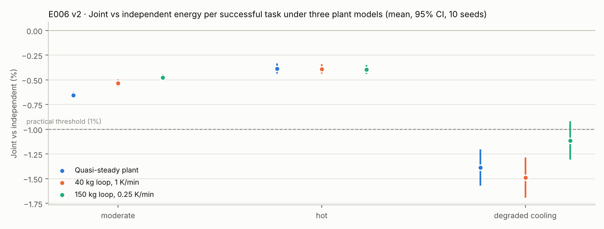

| Scenario | Plant | Joint vs independent [95% CI] | Verdict |
|---|---|---|---|
| S1_moderate | quasi_steady | -0.65% [-0.67%, -0.63%] | detectable reduction, not confirmed >= threshold |
| S1_moderate | dyn_40kg_1Kmin | -0.53% [-0.56%, -0.51%] | detectable reduction, not confirmed >= threshold |
| S1_moderate | dyn_150kg_0.25Kmin | -0.47% [-0.50%, -0.45%] | detectable reduction, not confirmed >= threshold |
| S3_hot | quasi_steady | -0.38% [-0.43%, -0.34%] | detectable reduction, not confirmed >= threshold |
| S3_hot | dyn_40kg_1Kmin | -0.39% [-0.43%, -0.35%] | detectable reduction, not confirmed >= threshold |
| S3_hot | dyn_150kg_0.25Kmin | -0.39% [-0.43%, -0.36%] | detectable reduction, not confirmed >= threshold |
| S6_degraded_cooling | quasi_steady | -1.39% [-1.56%, -1.21%] | meaningful reduction (CI beyond threshold) |
| S6_degraded_cooling | dyn_40kg_1Kmin | -1.49% [-1.68%, -1.29%] | meaningful reduction (CI beyond threshold) |
| S6_degraded_cooling | dyn_150kg_0.25Kmin | -1.11% [-1.30%, -0.93%] | detectable reduction, not confirmed >= threshold |

| Scenario | Plant | Policy | chip·s > 80 °C | chip·s throttled | Peak T_j (°C) | Loop storage (% of grid) |
|---|---|---|---|---|---|---|
| S1_moderate | dyn_150kg_0.25Kmin | fixed | 0 | 0 | 52.0 | +0.00% |
| S1_moderate | dyn_150kg_0.25Kmin | independent | 0 | 0 | 69.4 | +0.21% |
| S1_moderate | dyn_150kg_0.25Kmin | joint | 0 | 0 | 61.3 | +0.00% |
| S1_moderate | dyn_150kg_0.25Kmin | joint_robust | 0 | 0 | 61.3 | +0.00% |
| S1_moderate | dyn_40kg_1Kmin | fixed | 0 | 0 | 52.0 | +0.00% |
| S1_moderate | dyn_40kg_1Kmin | independent | 0 | 0 | 69.4 | +0.20% |
| S1_moderate | dyn_40kg_1Kmin | joint | 0 | 0 | 61.3 | +0.00% |
| S1_moderate | dyn_40kg_1Kmin | joint_robust | 0 | 0 | 61.3 | +0.00% |
| S1_moderate | quasi_steady | fixed | 0 | 0 | 52.0 | +0.00% |
| S1_moderate | quasi_steady | independent | 0 | 0 | 69.4 | +0.00% |
| S1_moderate | quasi_steady | joint | 0 | 0 | 61.3 | +0.00% |
| S1_moderate | quasi_steady | joint_robust | 0 | 0 | 61.3 | +0.00% |
| S3_hot | dyn_150kg_0.25Kmin | fixed | 0 | 0 | 52.0 | +0.00% |
| S3_hot | dyn_150kg_0.25Kmin | independent | 415 | 6 | 85.0 | -0.01% |
| S3_hot | dyn_150kg_0.25Kmin | joint | 0 | 0 | 76.6 | -0.00% |
| S3_hot | dyn_150kg_0.25Kmin | joint_robust | 0 | 0 | 76.6 | -0.00% |
| S3_hot | dyn_40kg_1Kmin | fixed | 0 | 0 | 52.0 | +0.00% |
| S3_hot | dyn_40kg_1Kmin | independent | 408 | 6 | 85.1 | -0.00% |
| S3_hot | dyn_40kg_1Kmin | joint | 0 | 0 | 76.6 | -0.00% |
| S3_hot | dyn_40kg_1Kmin | joint_robust | 0 | 0 | 76.6 | -0.00% |
| S3_hot | quasi_steady | fixed | 0 | 0 | 52.0 | +0.00% |
| S3_hot | quasi_steady | independent | 433 | 11 | 85.1 | -0.01% |
| S3_hot | quasi_steady | joint | 0 | 0 | 76.6 | -0.01% |
| S3_hot | quasi_steady | joint_robust | 0 | 0 | 76.6 | -0.01% |
| S6_degraded_cooling | dyn_150kg_0.25Kmin | fixed | 0 | 0 | 69.7 | +0.00% |
| S6_degraded_cooling | dyn_150kg_0.25Kmin | independent | 1256 | 152 | 85.5 | +0.85% |
| S6_degraded_cooling | dyn_150kg_0.25Kmin | joint | 421 | 0 | 81.1 | -0.04% |
| S6_degraded_cooling | dyn_150kg_0.25Kmin | joint_robust | 464 | 0 | 82.4 | -0.04% |
| S6_degraded_cooling | dyn_40kg_1Kmin | fixed | 0 | 0 | 69.7 | +0.00% |
| S6_degraded_cooling | dyn_40kg_1Kmin | independent | 1168 | 139 | 85.5 | -0.27% |
| S6_degraded_cooling | dyn_40kg_1Kmin | joint | 131 | 0 | 80.5 | -0.06% |
| S6_degraded_cooling | dyn_40kg_1Kmin | joint_robust | 176 | 0 | 81.4 | -0.05% |
| S6_degraded_cooling | quasi_steady | fixed | 0 | 0 | 69.7 | +0.00% |
| S6_degraded_cooling | quasi_steady | independent | 1182 | 171 | 85.5 | +0.00% |
| S6_degraded_cooling | quasi_steady | joint | 0 | 0 | 78.9 | +0.00% |
| S6_degraded_cooling | quasi_steady | joint_robust | 0 | 0 | 78.9 | +0.00% |

## E007 · Move suppression

Experiment `E007-20261026T185421-9da2d0`: 140 runs, 0 failed. Joint controller only.

| Scenario | Threshold | dt (s) | Action changes | Clock | Flow | Supply temp | Energy per success (kJ) |
|---|---|---|---|---|---|---|---|
| S1_moderate | 0.5% | 1 | 102.4 | 102.4 | 37.8 | 0.0 | 10.193 |
| S1_moderate | 2.0% | 0.5 | 101.1 | 101.1 | 35.8 | 0.0 | 10.172 |
| S1_moderate | 2.0% | 1 | 101.0 | 101.0 | 37.4 | 0.0 | 10.193 |
| S1_moderate | 5.0% | 0.5 | 88.0 | 88.0 | 34.8 | 0.0 | 10.208 |
| S1_moderate | 5.0% | 1 | 87.0 | 87.0 | 36.8 | 0.0 | 10.235 |
| S1_moderate | 0.0% | 0.5 | 104.3 | 103.1 | 37.0 | 0.0 | 10.171 |
| S1_moderate | 0.0% | 1 | 104.2 | 103.0 | 39.0 | 0.0 | 10.192 |
| S3_hot | 0.5% | 1 | 105.2 | 102.6 | 32.4 | 1.0 | 10.984 |
| S3_hot | 2.0% | 0.5 | 103.3 | 101.1 | 29.9 | 1.0 | 10.963 |
| S3_hot | 2.0% | 1 | 103.6 | 101.0 | 32.2 | 1.0 | 10.987 |
| S3_hot | 5.0% | 0.5 | 89.8 | 87.6 | 28.7 | 1.0 | 11.009 |
| S3_hot | 5.0% | 1 | 89.3 | 86.7 | 31.6 | 1.0 | 11.037 |
| S3_hot | 0.0% | 0.5 | 118.1 | 103.3 | 41.9 | 1.2 | 10.957 |
| S3_hot | 0.0% | 1 | 118.3 | 103.2 | 43.8 | 1.2 | 10.980 |

| Scenario | Threshold | Energy vs no threshold [95% CI] |
|---|---|---|
| S1_moderate | thr=0.005|dt=1.0 | +0.003% [-0.007%, +0.012%] |
| S3_hot | thr=0.005|dt=1.0 | +0.034% [+0.025%, +0.042%] |
| S1_moderate | thr=0.02|dt=1.0 | +0.006% [-0.017%, +0.029%] |
| S3_hot | thr=0.02|dt=1.0 | +0.055% [+0.034%, +0.077%] |
| S1_moderate | thr=0.05|dt=1.0 | +0.416% [+0.116%, +0.715%] |
| S3_hot | thr=0.05|dt=1.0 | +0.517% [+0.207%, +0.827%] |
| S1_moderate | thr=0.0|dt=1.0 | +0.000% [+0.000%, +0.000%] |
| S3_hot | thr=0.0|dt=1.0 | +0.000% [+0.000%, +0.000%] |

| Scenario | Threshold | Worst per-seed change dt 1 s vs 0.5 s | Mean | Seeds |
|---|---|---|---|---|
| S1_moderate | 0.0% | 0.388% | 0.215% | 10 |
| S3_hot | 0.0% | 0.382% | 0.219% | 10 |
| S1_moderate | 2.0% | 0.387% | 0.211% | 10 |
| S3_hot | 2.0% | 0.382% | 0.217% | 10 |
| S1_moderate | 5.0% | 0.524% | 0.267% | 10 |
| S3_hot | 5.0% | 0.500% | 0.263% | 10 |

## E008 · Self-correcting joint control under twin mismatch

Experiment `E008-20261026T185711-ac8eb3`: 210 runs, 0 failed. 5 seeds.

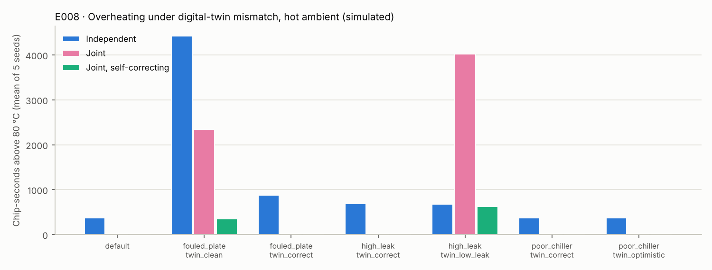

| Scenario | Truth \| twin | Self-correcting vs independent | vs joint | Joint vs independent | chip·s > 80 °C (I / J / J-sc) | throttled (I / J / J-sc) |
|---|---|---|---|---|---|---|
| S1_moderate | default | -0.68% [-0.72%, -0.64%] | +0.00% [+0.00%, +0.00%] | -0.68% [-0.72%, -0.64%] | 0 / 0 / 0 | 0 / 0 / 0 |
| S1_moderate | fouled_plate|twin_clean | -1.28% [-1.37%, -1.19%] | +0.00% [+0.00%, +0.00%] | -1.28% [-1.37%, -1.19%] | 398 / 0 / 0 | 0 / 0 / 0 |
| S1_moderate | fouled_plate|twin_correct | -0.63% [-0.74%, -0.52%] | +0.00% [+0.00%, +0.00%] | -0.63% [-0.74%, -0.52%] | 2 / 0 / 0 | 0 / 0 / 0 |
| S1_moderate | high_leak|twin_correct | -2.20% [-2.41%, -1.98%] | +0.00% [+0.00%, +0.00%] | -2.20% [-2.41%, -1.98%] | 0 / 0 / 0 | 0 / 0 / 0 |
| S1_moderate | high_leak|twin_low_leak | -1.58% [-1.83%, -1.32%] | +0.00% [+0.00%, +0.00%] | -1.58% [-1.83%, -1.32%] | 0 / 0 / 0 | 0 / 0 / 0 |
| S1_moderate | poor_chiller|twin_correct | -0.68% [-0.72%, -0.64%] | +0.00% [+0.00%, +0.00%] | -0.68% [-0.72%, -0.64%] | 0 / 0 / 0 | 0 / 0 / 0 |
| S1_moderate | poor_chiller|twin_optimistic | -0.68% [-0.72%, -0.64%] | +0.00% [+0.00%, +0.00%] | -0.68% [-0.72%, -0.64%] | 0 / 0 / 0 | 0 / 0 / 0 |
| S3_hot | default | -0.33% [-0.40%, -0.27%] | +0.00% [+0.00%, +0.01%] | -0.33% [-0.40%, -0.27%] | 369 / 0 / 0 | 8 / 0 / 0 |
| S3_hot | fouled_plate|twin_clean | -0.19% [-0.38%, -0.01%] | +0.14% [+0.06%, +0.22%] | -0.34% [-0.48%, -0.20%] | 4420 / 2341 / 353 | 357 / 9 / 0 |
| S3_hot | fouled_plate|twin_correct | -1.01% [-1.37%, -0.66%] | +0.06% [+0.01%, +0.11%] | -1.07% [-1.42%, -0.73%] | 878 / 0 / 0 | 120 / 0 / 0 |
| S3_hot | high_leak|twin_correct | -3.90% [-4.26%, -3.54%] | +0.00% [+0.00%, +0.00%] | -3.90% [-4.26%, -3.54%] | 682 / 0 / 0 | 89 / 0 / 0 |
| S3_hot | high_leak|twin_low_leak | +0.07% [-0.17%, +0.31%] | -0.63% [-0.79%, -0.46%] | +0.70% [+0.31%, +1.09%] | 680 / 4021 / 624 | 90 / 314 / 0 |
| S3_hot | poor_chiller|twin_correct | -0.27% [-0.38%, -0.17%] | +0.00% [+0.00%, +0.01%] | -0.27% [-0.38%, -0.17%] | 367 / 0 / 0 | 8 / 0 / 0 |
| S3_hot | poor_chiller|twin_optimistic | -0.29% [-0.37%, -0.22%] | +0.00% [+0.00%, +0.01%] | -0.30% [-0.37%, -0.22%] | 369 / 0 / 0 | 8 / 0 / 0 |

## E001C · Policy benchmark with measured clock sensitivity

Experiment `E001C-20261026T213353-ac0b5f`: 300 runs, 0 failed. Same design, seeds and workloads as E001 (`E001-20261026T181652-ada586`), with `beta_compute` = 0.983, `beta_memory` = 0.0 from M001. Changes are seed-paired against E001.

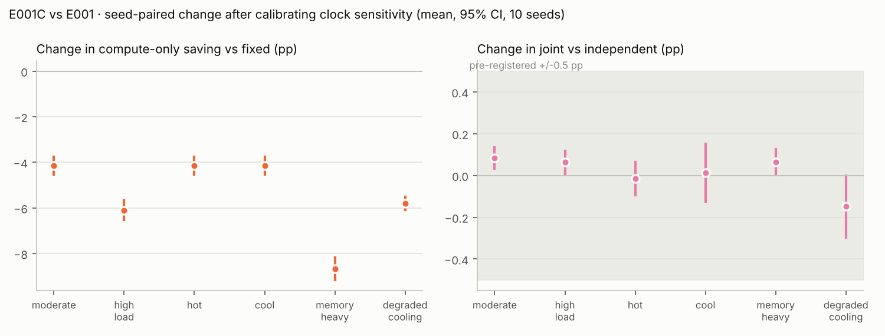

| Scenario | Compute-only vs fixed: E001 | E001C | change (pp, 95% CI) | Joint vs independent: E001 | E001C | change (pp, 95% CI) |
|---|---|---|---|---|---|---|
| S1_moderate | -29.5% | -33.6% | -4.14 [-4.53, -3.76] | -0.65% | -0.57% | +0.08 [+0.03, +0.13] |
| S2_high_load | -14.4% | -20.5% | -6.10 [-6.52, -5.68] | -1.04% | -0.97% | +0.06 [+0.01, +0.12] |
| S3_hot | -29.5% | -33.6% | -4.14 [-4.53, -3.76] | -0.33% | -0.34% | -0.01 [-0.09, +0.06] |
| S4_cool | -29.5% | -33.6% | -4.14 [-4.53, -3.76] | -1.36% | -1.34% | +0.01 [-0.12, +0.15] |
| S5_memory_heavy | -34.8% | -43.4% | -8.67 [-9.16, -8.17] | -0.58% | -0.52% | +0.06 [+0.00, +0.13] |
| S6_degraded_cooling | -24.3% | -30.1% | -5.80 [-6.09, -5.52] | -1.36% | -1.51% | -0.15 [-0.30, +0.00] |

### Energy per successful task in E001C (kJ, mean [95% CI])

| Scenario | Fixed baseline | Compute-only | Cooling-only | Independent | Joint |
|---|---|---|---|---|---|
| S1_moderate | 15.42 [15.27, 15.58] | 10.24 [10.03, 10.45] | 14.66 [14.51, 14.81] | 9.64 [9.44, 9.85] | 9.59 [9.39, 9.79] |
| S2_high_load | 14.05 [13.95, 14.14] | 11.16 [10.97, 11.36] | 13.41 [13.31, 13.50] | 10.60 [10.41, 10.79] | 10.49 [10.31, 10.68] |
| S3_hot | 16.82 [16.65, 16.99] | 11.17 [10.93, 11.40] | 15.59 [15.44, 15.75] | 10.38 [10.17, 10.60] | 10.35 [10.14, 10.56] |
| S4_cool | 14.21 [14.07, 14.36] | 9.44 [9.24, 9.63] | 14.10 [13.96, 14.24] | 9.27 [9.07, 9.46] | 9.14 [8.95, 9.34] |
| S5_memory_heavy | 14.10 [13.98, 14.23] | 7.98 [7.82, 8.14] | 13.39 [13.27, 13.50] | 7.49 [7.34, 7.65] | 7.45 [7.30, 7.60] |
| S6_degraded_cooling | 15.69 [15.54, 15.84] | 10.97 [10.73, 11.20] | 15.10 [14.96, 15.24] | 10.53 [10.30, 10.77] | 10.37 [10.14, 10.60] |

## E009 · Joint vs independent with leakage matched to the measured slope

Experiment `E009-20261026T221745-087238`: 360 runs, 0 failed. Leakage set so the simulator's chip power rises 0.135% per K at s = 0.747, 55.0 °C, as measured on the RTX 5070 (registry: 0.366% per K). Clock sensitivity from M001 throughout.

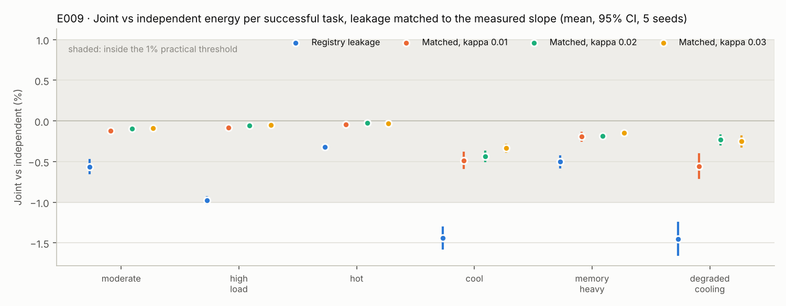

| Scenario | registry leakage | matched k0.01 | matched k0.02 | matched k0.03 | matched k0.02 low | matched k0.02 high |
|---|---|---|---|---|---|---|
| S1_moderate | -0.56% [-0.64%, -0.48%] | -0.12% [-0.12%, -0.11%] | -0.10% [-0.12%, -0.08%] | -0.09% [-0.11%, -0.07%] | -0.08% [-0.10%, -0.06%] | -0.14% [-0.16%, -0.13%] |
| S2_high_load | -0.98% [-1.01%, -0.94%] | -0.08% [-0.09%, -0.07%] | -0.06% [-0.07%, -0.04%] | -0.05% [-0.05%, -0.04%] | -0.02% [-0.02%, -0.01%] | -0.11% [-0.12%, -0.10%] |
| S3_hot | -0.32% [-0.33%, -0.31%] | -0.05% [-0.07%, -0.03%] | -0.03% [-0.05%, -0.01%] | -0.03% [-0.05%, -0.01%] | -0.01% [-0.01%, +0.00%] | -0.05% [-0.07%, -0.03%] |
| S4_cool | -1.44% [-1.57%, -1.31%] | -0.49% [-0.58%, -0.39%] | -0.43% [-0.49%, -0.38%] | -0.34% [-0.38%, -0.30%] | -0.36% [-0.42%, -0.30%] | -0.56% [-0.63%, -0.48%] |
| S5_memory_heavy | -0.50% [-0.57%, -0.43%] | -0.19% [-0.24%, -0.14%] | -0.18% [-0.22%, -0.15%] | -0.14% [-0.16%, -0.13%] | -0.13% [-0.16%, -0.10%] | -0.23% [-0.26%, -0.21%] |
| S6_degraded_cooling | -1.45% [-1.65%, -1.25%] | -0.56% [-0.70%, -0.41%] | -0.23% [-0.29%, -0.18%] | -0.25% [-0.32%, -0.19%] | -0.28% [-0.35%, -0.21%] | -0.42% [-0.50%, -0.34%] |

### Thermal guards (seed means): chip·s above 80 °C, independent / joint

| Scenario | registry leakage | matched k0.01 | matched k0.02 | matched k0.03 | matched k0.02 low | matched k0.02 high |
|---|---|---|---|---|---|---|
| S1_moderate | 0 / 0 | 0 / 0 | 0 / 0 | 0 / 0 | 0 / 0 | 0 / 0 |
| S2_high_load | 0 / 0 | 0 / 0 | 0 / 0 | 0 / 0 | 0 / 0 | 0 / 0 |
| S3_hot | 559 / 0 | 50 / 0 | 0 / 0 | 0 / 0 | 0 / 0 | 0 / 0 |
| S4_cool | 0 / 0 | 0 / 0 | 0 / 0 | 0 / 0 | 0 / 0 | 0 / 0 |
| S5_memory_heavy | 0 / 0 | 0 / 0 | 0 / 0 | 0 / 0 | 0 / 0 | 0 / 0 |
| S6_degraded_cooling | 1263 / 0 | 844 / 0 | 395 / 0 | 453 / 0 | 446 / 0 | 533 / 0 |

## E010 · Thermal safety under cooling degradation and heat

Experiment `E010-20261026T223109-050d5a`: 270 runs, 0 failed. S6 load profile; leakage matched to the measured slope and clock sensitivity from M001 in every cell; the twin knows the true cold-plate state. Thermal values are seed means over 5 seeds; energy is paired.

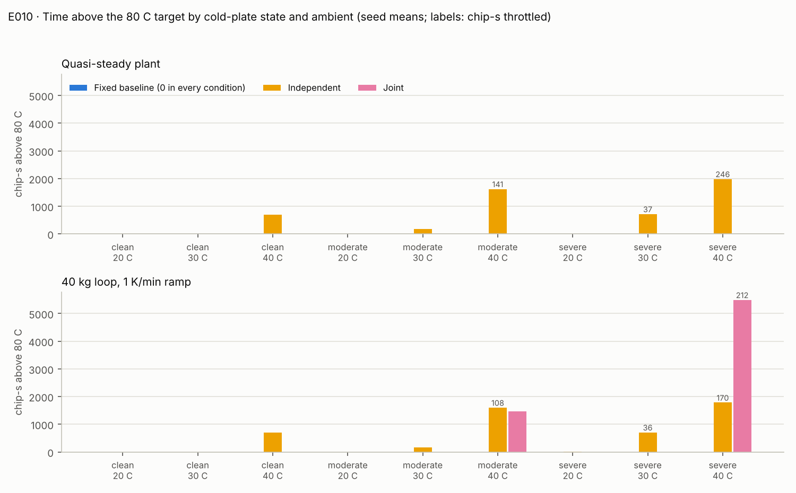

| Plant | Cold plate | Ambient | chip·s > 80 °C (F / I / J) | throttled (F / I / J) | peak °C (F / I / J) | Joint vs independent | Joint vs fixed |
|---|---|---|---|---|---|---|---|
| quasi | clean | 20 °C | 0 / 0 / 0 | 0 / 0 / 0 | 49.0 / 64.8 / 63.5 | -0.07% [-0.08%, -0.06%] | -35.6% [-37.1%, -34.0%] |
| quasi | clean | 30 °C | 0 / 0 / 0 | 0 / 0 / 0 | 49.0 / 74.6 / 69.3 | -0.04% [-0.05%, -0.03%] | -38.3% [-39.8%, -36.8%] |
| quasi | clean | 40 °C | 0 / 699 / 0 | 0 / 0 / 0 | 49.0 / 84.2 / 79.8 | -0.18% [-0.26%, -0.11%] | -40.5% [-41.9%, -39.1%] |
| quasi | moderate | 20 °C | 0 / 0 / 0 | 0 / 0 / 0 | 56.1 / 73.7 / 67.0 | -0.12% [-0.13%, -0.11%] | -35.5% [-37.0%, -33.9%] |
| quasi | moderate | 30 °C | 0 / 173 / 0 | 0 / 0 / 0 | 56.1 / 82.4 / 77.6 | -0.05% [-0.07%, -0.03%] | -38.1% [-39.6%, -36.7%] |
| quasi | moderate | 40 °C | 0 / 1624 / 0 | 0 / 141 / 0 | 56.1 / 85.3 / 79.9 | -1.50% [-1.77%, -1.24%] | -39.6% [-41.1%, -38.0%] |
| quasi | severe | 20 °C | 0 / 8 / 0 | 0 / 0 / 0 | 63.4 / 80.1 / 75.1 | -0.12% [-0.14%, -0.10%] | -35.4% [-37.0%, -33.8%] |
| quasi | severe | 30 °C | 0 / 719 / 0 | 0 / 37 / 0 | 63.4 / 85.3 / 78.4 | -0.63% [-0.79%, -0.48%] | -37.8% [-39.3%, -36.2%] |
| quasi | severe | 40 °C | 0 / 1985 / 0 | 0 / 246 / 0 | 63.4 / 85.5 / 79.7 | -1.80% [-2.13%, -1.47%] | -37.9% [-39.7%, -36.2%] |
| dyn40 | clean | 20 °C | 0 / 0 / 0 | 0 / 0 / 0 | 49.0 / 64.2 / 63.5 | -0.04% [-0.05%, -0.03%] | -35.6% [-37.1%, -34.0%] |
| dyn40 | clean | 30 °C | 0 / 0 / 0 | 0 / 0 / 0 | 49.0 / 74.6 / 69.3 | -0.04% [-0.05%, -0.03%] | -38.3% [-39.8%, -36.8%] |
| dyn40 | clean | 40 °C | 0 / 704 / 0 | 0 / 0 / 0 | 49.0 / 84.1 / 79.8 | -0.17% [-0.24%, -0.10%] | -40.5% [-41.9%, -39.1%] |
| dyn40 | moderate | 20 °C | 0 / 0 / 0 | 0 / 0 / 0 | 56.1 / 73.8 / 67.0 | -0.09% [-0.11%, -0.07%] | -35.5% [-37.0%, -33.9%] |
| dyn40 | moderate | 30 °C | 0 / 173 / 0 | 0 / 0 / 0 | 56.1 / 82.4 / 77.6 | -0.05% [-0.07%, -0.03%] | -38.1% [-39.6%, -36.7%] |
| dyn40 | moderate | 40 °C | 0 / 1602 / 1473 | 0 / 108 / 0 | 56.1 / 85.3 / 81.5 | -1.60% [-2.00%, -1.19%] | -39.6% [-41.2%, -38.1%] |
| dyn40 | severe | 20 °C | 0 / 8 / 0 | 0 / 0 / 0 | 63.4 / 80.2 / 75.1 | -0.07% [-0.09%, -0.05%] | -35.4% [-37.0%, -33.8%] |
| dyn40 | severe | 30 °C | 0 / 709 / 0 | 0 / 36 / 0 | 63.4 / 85.3 / 78.4 | -0.62% [-0.77%, -0.46%] | -37.8% [-39.3%, -36.2%] |
| dyn40 | severe | 40 °C | 0 / 1785 / 5493 | 0 / 170 / 212 | 63.4 / 85.5 / 85.1 | -2.41% [-3.17%, -1.64%] | -38.1% [-40.0%, -36.1%] |

## E011 · Lag-aware joint control

Experiment `E011-20261027T024211-6b9ce0`: 405 runs, 0 failed. As E010 plus a 150 kg loop with a 0.25 K/min ramp; `joint_lag` checks thermal safety at the supply temperature the chips will actually see before the next decision. Thermal values are seed means over 5 seeds; energy is paired. **The energy columns mix two changes** (lag-awareness and a different overload fallback); E011B separates them.

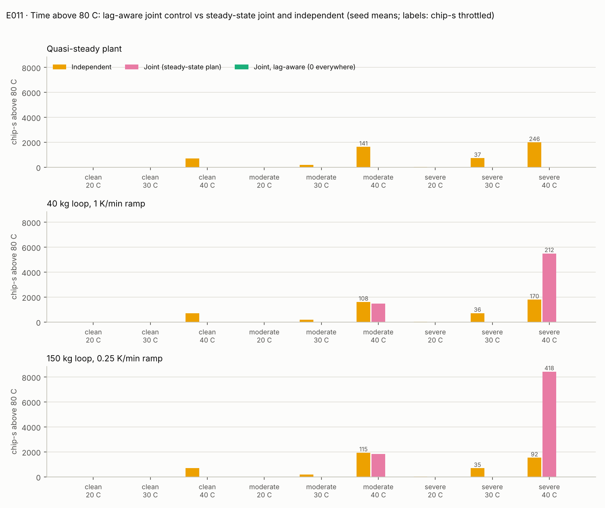

| Plant | Cold plate | Ambient | chip·s > 80 °C (I / J / JL) | throttled (I / J / JL) | late tasks (I / J / JL) | JL vs J | JL vs I |
|---|---|---|---|---|---|---|---|
| quasi | clean | 20 °C | 0 / 0 / 0 | 0 / 0 / 0 | 2.0 / 2.0 / 2.0 | +0.00% [+0.00%, +0.00%] | -0.07% [-0.08%, -0.06%] |
| quasi | clean | 30 °C | 0 / 0 / 0 | 0 / 0 / 0 | 2.0 / 2.0 / 2.0 | +0.00% [+0.00%, +0.00%] | -0.04% [-0.05%, -0.03%] |
| quasi | clean | 40 °C | 699 / 0 / 0 | 0 / 0 / 0 | 2.0 / 2.0 / 2.0 | +0.00% [+0.00%, +0.00%] | -0.18% [-0.26%, -0.11%] |
| quasi | moderate | 20 °C | 0 / 0 / 0 | 0 / 0 / 0 | 2.0 / 2.0 / 2.0 | +0.00% [+0.00%, +0.00%] | -0.12% [-0.13%, -0.11%] |
| quasi | moderate | 30 °C | 173 / 0 / 0 | 0 / 0 / 0 | 2.0 / 2.0 / 2.0 | +0.00% [+0.00%, +0.00%] | -0.05% [-0.07%, -0.03%] |
| quasi | moderate | 40 °C | 1624 / 0 / 0 | 141 / 0 / 0 | 2.0 / 2.0 / 2.0 | +0.00% [+0.00%, +0.00%] | -1.50% [-1.77%, -1.24%] |
| quasi | severe | 20 °C | 8 / 0 / 0 | 0 / 0 / 0 | 2.0 / 2.0 / 2.0 | +0.00% [+0.00%, +0.00%] | -0.12% [-0.14%, -0.10%] |
| quasi | severe | 30 °C | 719 / 0 / 0 | 37 / 0 / 0 | 2.0 / 2.0 / 2.0 | +0.00% [+0.00%, +0.00%] | -0.63% [-0.79%, -0.48%] |
| quasi | severe | 40 °C | 1985 / 0 / 0 | 246 / 0 / 0 | 2.0 / 2.0 / 2.0 | +0.00% [+0.00%, +0.00%] | -1.80% [-2.13%, -1.47%] |
| dyn40 | clean | 20 °C | 0 / 0 / 0 | 0 / 0 / 0 | 2.0 / 2.0 / 2.0 | -4.63% [-5.82%, -3.43%] | -4.66% [-5.86%, -3.47%] |
| dyn40 | clean | 30 °C | 0 / 0 / 0 | 0 / 0 / 0 | 2.0 / 2.0 / 2.0 | -4.60% [-5.79%, -3.42%] | -4.64% [-5.84%, -3.44%] |
| dyn40 | clean | 40 °C | 704 / 0 / 0 | 0 / 0 / 0 | 2.0 / 2.0 / 2.0 | -4.58% [-5.77%, -3.40%] | -4.75% [-5.90%, -3.59%] |
| dyn40 | moderate | 20 °C | 0 / 0 / 0 | 0 / 0 / 0 | 2.0 / 2.0 / 2.0 | -4.65% [-5.84%, -3.45%] | -4.73% [-5.94%, -3.52%] |
| dyn40 | moderate | 30 °C | 173 / 0 / 0 | 0 / 0 / 0 | 2.0 / 2.0 / 2.0 | -4.64% [-5.83%, -3.44%] | -4.68% [-5.87%, -3.50%] |
| dyn40 | moderate | 40 °C | 1602 / 1473 / 0 | 108 / 0 / 0 | 2.0 / 2.0 / 2.0 | -2.90% [-3.89%, -1.92%] | -4.46% [-5.15%, -3.76%] |
| dyn40 | severe | 20 °C | 8 / 0 / 0 | 0 / 0 / 0 | 2.0 / 2.0 / 2.0 | -4.68% [-5.89%, -3.47%] | -4.75% [-5.95%, -3.54%] |
| dyn40 | severe | 30 °C | 709 / 0 / 0 | 36 / 0 / 0 | 2.0 / 2.0 / 2.0 | -4.59% [-5.77%, -3.41%] | -5.18% [-6.22%, -4.15%] |
| dyn40 | severe | 40 °C | 1785 / 5493 / 0 | 170 / 212 / 0 | 2.0 / 2.0 / 7.6 | -8.77% [-10.88%, -6.66%] | -10.97% [-12.47%, -9.48%] |
| dyn150 | clean | 20 °C | 0 / 0 / 0 | 0 / 0 / 0 | 2.0 / 2.0 / 2.0 | -4.63% [-5.82%, -3.43%] | -4.64% [-5.84%, -3.45%] |
| dyn150 | clean | 30 °C | 0 / 0 / 0 | 0 / 0 / 0 | 2.0 / 2.0 / 2.0 | -4.60% [-5.79%, -3.42%] | -4.64% [-5.84%, -3.44%] |
| dyn150 | clean | 40 °C | 705 / 0 / 0 | 0 / 0 / 0 | 2.0 / 2.0 / 2.0 | -4.58% [-5.77%, -3.40%] | -4.75% [-5.91%, -3.59%] |
| dyn150 | moderate | 20 °C | 0 / 0 / 0 | 0 / 0 / 0 | 2.0 / 2.0 / 2.0 | -4.65% [-5.84%, -3.45%] | -4.71% [-5.92%, -3.49%] |
| dyn150 | moderate | 30 °C | 173 / 0 / 0 | 0 / 0 / 0 | 2.0 / 2.0 / 2.0 | -4.64% [-5.83%, -3.44%] | -4.68% [-5.87%, -3.50%] |
| dyn150 | moderate | 40 °C | 1936 / 1820 / 0 | 115 / 0 / 0 | 2.0 / 2.0 / 2.0 | -2.85% [-3.88%, -1.82%] | -4.23% [-4.94%, -3.52%] |
| dyn150 | severe | 20 °C | 7 / 0 / 0 | 0 / 0 / 0 | 2.0 / 2.0 / 2.0 | -4.68% [-5.89%, -3.47%] | -4.72% [-5.92%, -3.53%] |
| dyn150 | severe | 30 °C | 683 / 0 / 0 | 35 / 0 / 0 | 2.0 / 2.0 / 2.0 | -4.59% [-5.77%, -3.41%] | -5.15% [-6.18%, -4.12%] |
| dyn150 | severe | 40 °C | 1523 / 8433 / 0 | 92 / 418 / 0 | 2.0 / 2.0 / 7.6 | -7.91% [-10.59%, -5.23%] | -10.80% [-12.29%, -9.31%] |

## E011B · Ablation: overload fallback vs lag-awareness

Experiment `E011B-20261027T030500-ae8b52`: 405 runs, 0 failed. Registered after E011's results were seen. `joint_fb` is steady-state joint control with `joint_lag`'s overload fallback, so joint_fb vs joint isolates the fallback and joint_lag vs joint_fb isolates lag-awareness. Energy is paired over 5 seeds; thermal values and late tasks are seed means.

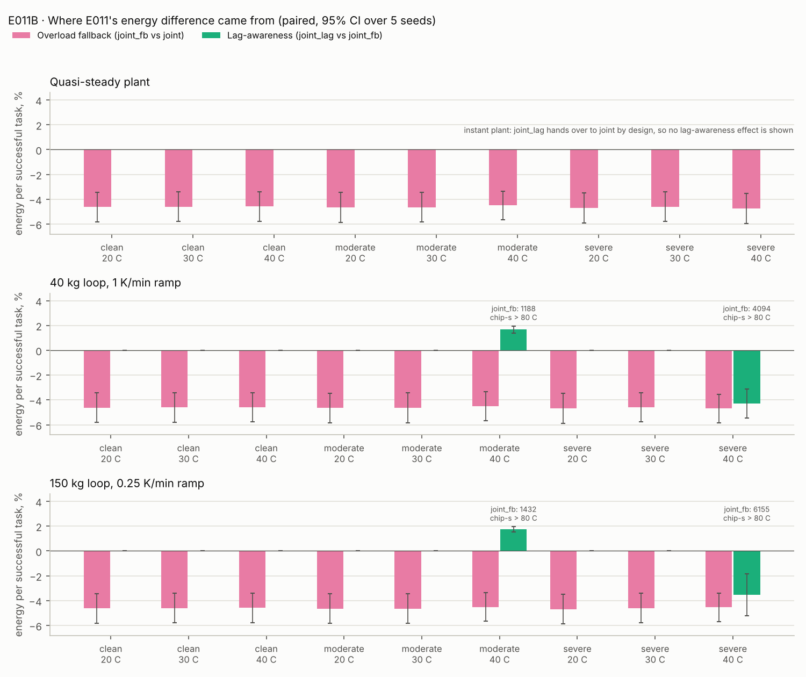

| Plant | Cold plate | Ambient | Fallback: FB vs J | Lag-awareness: JL vs FB | Total: JL vs J | chip·s > 80 °C (J / FB / JL) | late tasks (J / FB / JL) |
|---|---|---|---|---|---|---|---|
| quasi | clean | 20 °C | -4.63% [-5.82%, -3.43%] | n/a¹ | +0.00% [+0.00%, +0.00%] | 0 / 0 / 0 | 2.0 / 2.0 / 2.0 |
| quasi | clean | 30 °C | -4.60% [-5.79%, -3.42%] | n/a¹ | +0.00% [+0.00%, +0.00%] | 0 / 0 / 0 | 2.0 / 2.0 / 2.0 |
| quasi | clean | 40 °C | -4.58% [-5.77%, -3.40%] | n/a¹ | +0.00% [+0.00%, +0.00%] | 0 / 0 / 0 | 2.0 / 2.0 / 2.0 |
| quasi | moderate | 20 °C | -4.65% [-5.84%, -3.45%] | n/a¹ | +0.00% [+0.00%, +0.00%] | 0 / 0 / 0 | 2.0 / 2.0 / 2.0 |
| quasi | moderate | 30 °C | -4.64% [-5.83%, -3.44%] | n/a¹ | +0.00% [+0.00%, +0.00%] | 0 / 0 / 0 | 2.0 / 2.0 / 2.0 |
| quasi | moderate | 40 °C | -4.50% [-5.65%, -3.34%] | n/a¹ | +0.00% [+0.00%, +0.00%] | 0 / 0 / 0 | 2.0 / 2.0 / 2.0 |
| quasi | severe | 20 °C | -4.68% [-5.89%, -3.47%] | n/a¹ | +0.00% [+0.00%, +0.00%] | 0 / 0 / 0 | 2.0 / 2.0 / 2.0 |
| quasi | severe | 30 °C | -4.59% [-5.77%, -3.41%] | n/a¹ | +0.00% [+0.00%, +0.00%] | 0 / 0 / 0 | 2.0 / 2.0 / 2.0 |
| quasi | severe | 40 °C | -4.74% [-5.96%, -3.52%] | n/a¹ | +0.00% [+0.00%, +0.00%] | 0 / 0 / 0 | 2.0 / 2.0 / 2.0 |
| dyn40 | clean | 20 °C | -4.63% [-5.82%, -3.43%] | +0.00% [+0.00%, +0.00%] | -4.63% [-5.82%, -3.43%] | 0 / 0 / 0 | 2.0 / 2.0 / 2.0 |
| dyn40 | clean | 30 °C | -4.60% [-5.79%, -3.42%] | +0.00% [+0.00%, +0.00%] | -4.60% [-5.79%, -3.42%] | 0 / 0 / 0 | 2.0 / 2.0 / 2.0 |
| dyn40 | clean | 40 °C | -4.58% [-5.77%, -3.40%] | +0.00% [+0.00%, +0.00%] | -4.58% [-5.77%, -3.40%] | 0 / 0 / 0 | 2.0 / 2.0 / 2.0 |
| dyn40 | moderate | 20 °C | -4.65% [-5.84%, -3.45%] | +0.00% [+0.00%, +0.00%] | -4.65% [-5.84%, -3.45%] | 0 / 0 / 0 | 2.0 / 2.0 / 2.0 |
| dyn40 | moderate | 30 °C | -4.64% [-5.83%, -3.44%] | +0.00% [+0.00%, +0.00%] | -4.64% [-5.83%, -3.44%] | 0 / 0 / 0 | 2.0 / 2.0 / 2.0 |
| dyn40 | moderate | 40 °C | -4.50% [-5.66%, -3.35%] | +1.68% [+1.41%, +1.95%] | -2.90% [-3.89%, -1.92%] | 1473 / 1188 / 0 | 2.0 / 2.0 / 2.0 |
| dyn40 | severe | 20 °C | -4.68% [-5.89%, -3.47%] | +0.00% [+0.00%, +0.00%] | -4.68% [-5.89%, -3.47%] | 0 / 0 / 0 | 2.0 / 2.0 / 2.0 |
| dyn40 | severe | 30 °C | -4.59% [-5.77%, -3.41%] | +0.00% [+0.00%, +0.00%] | -4.59% [-5.77%, -3.41%] | 0 / 0 / 0 | 2.0 / 2.0 / 2.0 |
| dyn40 | severe | 40 °C | -4.69% [-5.84%, -3.55%] | -4.28% [-5.46%, -3.10%] | -8.77% [-10.88%, -6.66%] | 5493 / 4094 / 0 | 2.0 / 2.2 / 7.6 |
| dyn150 | clean | 20 °C | -4.63% [-5.82%, -3.43%] | +0.00% [+0.00%, +0.00%] | -4.63% [-5.82%, -3.43%] | 0 / 0 / 0 | 2.0 / 2.0 / 2.0 |
| dyn150 | clean | 30 °C | -4.60% [-5.79%, -3.42%] | +0.00% [+0.00%, +0.00%] | -4.60% [-5.79%, -3.42%] | 0 / 0 / 0 | 2.0 / 2.0 / 2.0 |
| dyn150 | clean | 40 °C | -4.58% [-5.77%, -3.40%] | +0.00% [+0.00%, +0.00%] | -4.58% [-5.77%, -3.40%] | 0 / 0 / 0 | 2.0 / 2.0 / 2.0 |
| dyn150 | moderate | 20 °C | -4.65% [-5.84%, -3.45%] | +0.00% [+0.00%, +0.00%] | -4.65% [-5.84%, -3.45%] | 0 / 0 / 0 | 2.0 / 2.0 / 2.0 |
| dyn150 | moderate | 30 °C | -4.64% [-5.83%, -3.44%] | +0.00% [+0.00%, +0.00%] | -4.64% [-5.83%, -3.44%] | 0 / 0 / 0 | 2.0 / 2.0 / 2.0 |
| dyn150 | moderate | 40 °C | -4.51% [-5.66%, -3.36%] | +1.74% [+1.52%, +1.95%] | -2.85% [-3.88%, -1.82%] | 1820 / 1432 / 0 | 2.0 / 2.0 / 2.0 |
| dyn150 | severe | 20 °C | -4.68% [-5.89%, -3.47%] | +0.00% [+0.00%, +0.00%] | -4.68% [-5.89%, -3.47%] | 0 / 0 / 0 | 2.0 / 2.0 / 2.0 |
| dyn150 | severe | 30 °C | -4.59% [-5.77%, -3.41%] | +0.00% [+0.00%, +0.00%] | -4.59% [-5.77%, -3.41%] | 0 / 0 / 0 | 2.0 / 2.0 / 2.0 |
| dyn150 | severe | 40 °C | -4.54% [-5.68%, -3.39%] | -3.54% [-5.23%, -1.85%] | -7.91% [-10.59%, -5.23%] | 8433 / 6155 / 0 | 2.0 / 2.6 / 7.6 |

¹ With an instant plant `joint_lag` hands over to steady-state joint control by design, including joint's original fallback, so joint_lag vs joint_fb there only measures the fallback again.

## E012 · Warm water on real silicon

Experiment `E012-20261027T032027-7b1f8c`: 360 runs, 0 failed. Registry placeholders vs RTX 5070-derived parameters (clock sensitivity, leakage matched to the measured slope, voltage-floor V-f form); supply floor none or 40 °C; instant plant or 150 kg loop. Heat is counted as reusable when the water leaving the loop is at least 45 °C. Seed means over 5 seeds. **Caveat (independent audit):** the plant's dry-cooler fan power is proportional to heat rejected, independent of approach temperature, so above the free-cooling limit warmer water has no facility-side benefit and H1/H2 could not have passed. "measured" = simulated with RTX 5070-derived parameters.

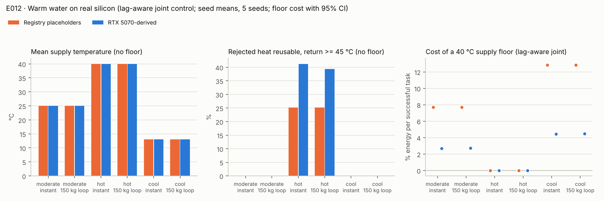

| Scenario | Plant | World | Floor | Mean supply °C (I / J / JL) | Reusable heat (I / J / JL) | chip·s > 80 °C (I / J / JL) | late tasks (I / J / JL) |
|---|---|---|---|---|---|---|---|
| S1_moderate | quasi | registry | nofloor | 25.5 / 25.0 / 25.0 | 0% / 0% / 0% | 0 / 0 / 0 | 0.4 / 0.4 / 0.4 |
| S1_moderate | dyn150 | registry | nofloor | 25.0 / 25.0 / 25.0 | 0% / 0% / 0% | 0 / 0 / 0 | 0.4 / 0.4 / 0.4 |
| S1_moderate | quasi | registry | floor40 | 40.0 / 40.0 / 40.0 | 42% / 25% / 25% | 398 / 0 / 0 | 0.4 / 0.4 / 0.4 |
| S1_moderate | dyn150 | registry | floor40 | 40.0 / 40.0 / 40.0 | 42% / 25% / 25% | 398 / 0 / 0 | 0.4 / 0.4 / 0.4 |
| S1_moderate | quasi | measured | nofloor | 25.7 / 25.0 / 25.0 | 0% / 0% / 0% | 0 / 0 / 0 | 0.4 / 0.4 / 0.4 |
| S1_moderate | dyn150 | measured | nofloor | 25.1 / 25.0 / 25.0 | 0% / 0% / 0% | 0 / 0 / 0 | 0.4 / 0.4 / 0.4 |
| S1_moderate | quasi | measured | floor40 | 40.0 / 40.0 / 40.0 | 42% / 41% / 41% | 0 / 0 / 0 | 0.4 / 0.4 / 0.4 |
| S1_moderate | dyn150 | measured | floor40 | 40.0 / 40.0 / 40.0 | 42% / 41% / 39% | 0 / 0 / 0 | 0.4 / 0.4 / 0.4 |
| S3_hot | quasi | registry | nofloor | 39.8 / 40.0 / 40.0 | 43% / 25% / 25% | 400 / 0 / 0 | 0.4 / 0.4 / 0.4 |
| S3_hot | dyn150 | registry | nofloor | 39.8 / 40.0 / 40.0 | 44% / 25% / 25% | 368 / 0 / 0 | 0.4 / 0.4 / 0.4 |
| S3_hot | quasi | registry | floor40 | 40.0 / 40.0 / 40.0 | 42% / 25% / 25% | 398 / 0 / 0 | 0.4 / 0.4 / 0.4 |
| S3_hot | dyn150 | registry | floor40 | 40.0 / 40.0 / 40.0 | 42% / 25% / 25% | 398 / 0 / 0 | 0.4 / 0.4 / 0.4 |
| S3_hot | quasi | measured | nofloor | 40.0 / 40.0 / 40.0 | 42% / 41% / 41% | 0 / 0 / 0 | 0.4 / 0.4 / 0.4 |
| S3_hot | dyn150 | measured | nofloor | 40.0 / 40.0 / 40.0 | 42% / 41% / 39% | 0 / 0 / 0 | 0.4 / 0.4 / 0.4 |
| S3_hot | quasi | measured | floor40 | 40.0 / 40.0 / 40.0 | 42% / 41% / 41% | 0 / 0 / 0 | 0.4 / 0.4 / 0.4 |
| S3_hot | dyn150 | measured | floor40 | 40.0 / 40.0 / 40.0 | 42% / 41% / 39% | 0 / 0 / 0 | 0.4 / 0.4 / 0.4 |
| S4_cool | quasi | registry | nofloor | 15.8 / 13.0 / 13.0 | 0% / 0% / 0% | 0 / 0 / 0 | 0.4 / 0.4 / 0.4 |
| S4_cool | dyn150 | registry | nofloor | 13.1 / 13.0 / 13.0 | 0% / 0% / 0% | 0 / 0 / 0 | 0.4 / 0.4 / 0.4 |
| S4_cool | quasi | registry | floor40 | 40.0 / 40.0 / 40.0 | 42% / 25% / 25% | 398 / 0 / 0 | 0.4 / 0.4 / 0.4 |
| S4_cool | dyn150 | registry | floor40 | 40.0 / 40.0 / 40.0 | 42% / 25% / 25% | 398 / 0 / 0 | 0.4 / 0.4 / 0.4 |
| S4_cool | quasi | measured | nofloor | 15.9 / 13.0 / 13.0 | 0% / 0% / 0% | 0 / 0 / 0 | 0.4 / 0.4 / 0.4 |
| S4_cool | dyn150 | measured | nofloor | 13.1 / 13.0 / 13.0 | 0% / 0% / 0% | 0 / 0 / 0 | 0.4 / 0.4 / 0.4 |
| S4_cool | quasi | measured | floor40 | 40.0 / 40.0 / 40.0 | 42% / 41% / 41% | 0 / 0 / 0 | 0.4 / 0.4 / 0.4 |
| S4_cool | dyn150 | measured | floor40 | 40.0 / 40.0 / 40.0 | 42% / 41% / 39% | 0 / 0 / 0 | 0.4 / 0.4 / 0.4 |

### Cost of the 40 °C floor for lag-aware joint control (energy per successful task, paired)

| Scenario | Plant | Registry world | Measured world | Registry minus measured |
|---|---|---|---|---|
| S1_moderate | quasi | +7.70% [+7.61%, +7.79%] | +2.71% [+2.65%, +2.77%] | +4.99% [+4.95%, +5.02%] |
| S1_moderate | dyn150 | +7.70% [+7.61%, +7.79%] | +2.74% [+2.69%, +2.79%] | +4.96% [+4.91%, +5.01%] |
| S3_hot | quasi | +0.00% [+0.00%, +0.00%] | +0.00% [+0.00%, +0.00%] | +0.00% [+0.00%, +0.00%] |
| S3_hot | dyn150 | +0.00% [+0.00%, +0.00%] | +0.00% [+0.00%, +0.00%] | +0.00% [+0.00%, +0.00%] |
| S4_cool | quasi | +12.86% [+12.71%, +13.01%] | +4.43% [+4.33%, +4.53%] | +8.43% [+8.37%, +8.49%] |
| S4_cool | dyn150 | +12.86% [+12.71%, +13.01%] | +4.48% [+4.40%, +4.56%] | +8.38% [+8.30%, +8.46%] |

## E013 · Fixed thermal margin vs lag-aware planning

Experiment `E013-20261027T033335-e7198c`: 300 runs, 0 failed. `joint_fb` plans against 80 − m °C; `joint_lag` plans against 80 °C. Time above target is always measured against 80 °C. Smallest margin with no time above 80 °C in every condition: none of those tested.

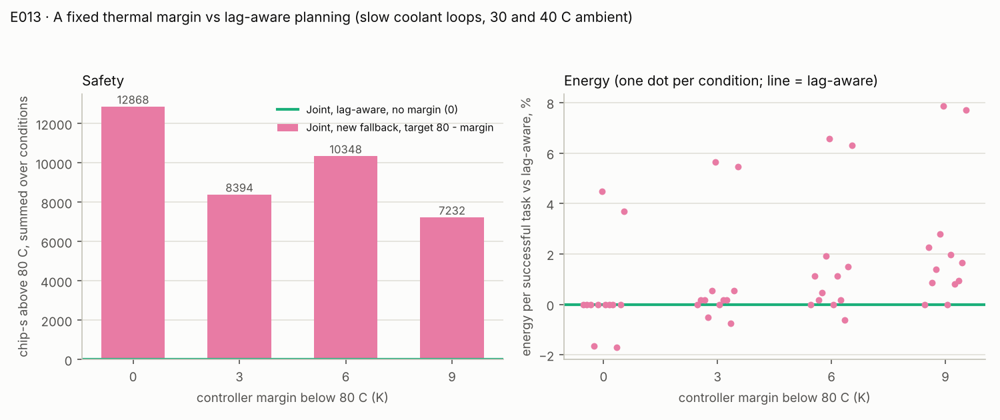

| Loop | Cold plate | Ambient | chip·s > 80 °C, joint_fb at m = 0 / 3 / 6 / 9 | joint_lag | joint_fb energy vs joint_lag at m = 0 / 3 / 6 / 9 | late tasks joint_fb (m*) / joint_lag |
|---|---|---|---|---|---|---|
| dyn40 | clean | 30 °C | 0 / 0 / 0 / 0 | 0 | +0.00% / +0.00% / +0.00% / +0.00% | 2.0 / 2.0 |
| dyn40 | clean | 40 °C | 0 / 0 / 0 / 0 | 0 | +0.00% / +0.18% / +1.11% / +2.27% | 2.0 / 2.0 |
| dyn40 | moderate | 30 °C | 0 / 0 / 0 / 0 | 0 | +0.00% / +0.16% / +0.16% / +0.87% | 2.0 / 2.0 |
| dyn40 | moderate | 40 °C | 1188 / 500 / 1258 / 673 | 0 | -1.65% / -0.53% / +0.47% / +1.39% | 2.0 / 2.0 |
| dyn40 | severe | 30 °C | 0 / 0 / 0 / 3 | 0 | +0.00% / +0.55% / +1.92% / +2.79% | 2.0 / 2.0 |
| dyn40 | severe | 40 °C | 4094 / 2404 / 1941 / 1383 | 0 | +4.48% / +5.65% / +6.58% / +7.87% | 2.0 / 7.6 |
| dyn150 | clean | 30 °C | 0 / 0 / 0 / 0 | 0 | +0.00% / +0.00% / +0.00% / +0.00% | 2.0 / 2.0 |
| dyn150 | clean | 40 °C | 0 / 0 / 0 / 0 | 0 | +0.00% / +0.18% / +1.11% / +1.96% | 2.0 / 2.0 |
| dyn150 | moderate | 30 °C | 0 / 0 / 0 / 0 | 0 | +0.00% / +0.16% / +0.16% / +0.81% | 2.0 / 2.0 |
| dyn150 | moderate | 40 °C | 1432 / 857 / 2772 / 1392 | 0 | -1.71% / -0.74% / -0.61% / +0.94% | 2.0 / 2.0 |
| dyn150 | severe | 30 °C | 0 / 0 / 0 / 36 | 0 | +0.00% / +0.55% / +1.49% / +1.65% | 2.0 / 2.0 |
| dyn150 | severe | 40 °C | 6155 / 4633 / 4376 / 3744 | 0 | +3.69% / +5.47% / +6.31% / +7.70% | 2.0 / 7.6 |

## E014 · Loop-model error and a model-free ablation

Experiment `E014-20261027T034608-cc32d7`: 180 runs, 0 failed. `joint_lag` with its loop mass and ramp wrong by 4× either way; `joint_meas` checks safety at max(measured supply, setpoint) with no loop model. 40 °C ambient, both slow loops. Energy paired against exact-model `joint_lag`.

| Loop | Cold plate | chip·s > 80 °C, joint_lag: exact / mass_x0.25 / mass_x4 / ramp_x0.25 / ramp_x4 | joint_meas | late tasks joint_lag (exact) / joint_meas | joint_meas vs joint_lag | wrong-model energy range |
|---|---|---|---|---|---|---|
| dyn40 | clean | 0 / 0 / 0 / 0 / 0 | 0 | 2.0 / 2.0 | +0.00% [+0.00%, +0.00%] | +0.00% to +0.00% |
| dyn40 | moderate | 0 / 0 / 0 / 0 / 0 | 0 | 2.0 / 2.0 | +0.00% [+0.00%, +0.00%] | +0.00% to +0.00% |
| dyn40 | severe | 0 / 0 / 0 / 0 / 0 | 0 | 7.6 / 7.6 | +0.00% [+0.00%, +0.00%] | +0.00% to +0.00% |
| dyn150 | clean | 0 / 0 / 0 / 0 / 0 | 0 | 2.0 / 2.0 | +0.00% [+0.00%, +0.00%] | +0.00% to +0.00% |
| dyn150 | moderate | 0 / 0 / 0 / 0 / 0 | 0 | 2.0 / 2.0 | +0.00% [+0.00%, +0.00%] | +0.00% to +0.00% |
| dyn150 | severe | 0 / 0 / 0 / 0 / 0 | 0 | 7.6 / 7.6 | +0.00% [+0.00%, +0.00%] | +0.00% to +0.00% |

## E015 · Thermal futures (multi-step MPC)

Experiment `E015-20261101T190855-b96873`: 1320 runs, 0 failed. Late tasks are seed means; energy is paired against joint_meas (the measured-state rule) within each condition. All simulated.

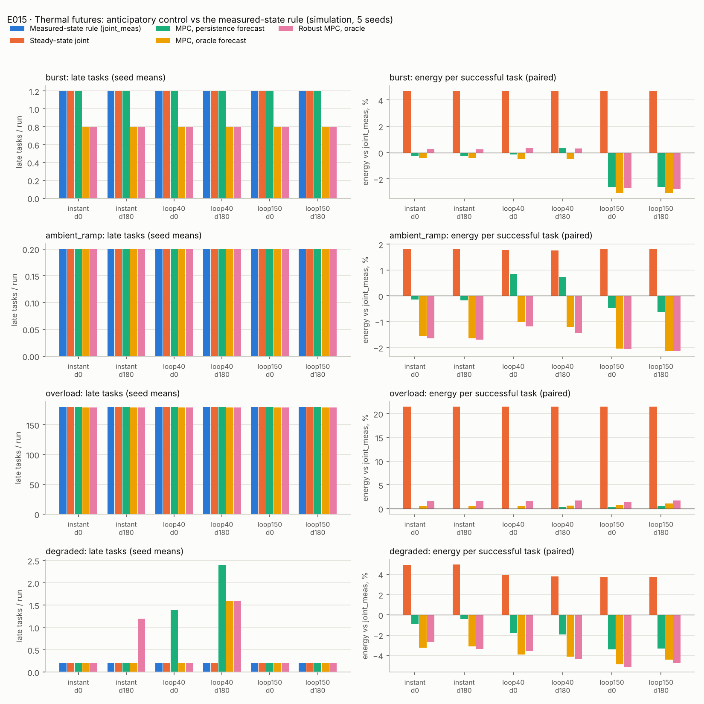

| Scenario | Plant | Delay | late: meas / joint / indep / MPC pers / MPC oracle / robust oracle | MPC oracle energy vs meas | chip·s > 80 °C: joint / MPC oracle |
|---|---|---|---|---|---|
| burst | instant | d0 | 1.2 / 1.2 / 1.2 / 1.2 / 0.8 / 0.8 | -0.40% [-1.87%, +1.07%] | 0 / 0 |
| burst | instant | d180 | 1.2 / 1.2 / 1.2 / 1.2 / 0.8 / 0.8 | -0.40% [-1.87%, +1.07%] | 0 / 0 |
| burst | loop40 | d0 | 1.2 / 1.2 / 1.2 / 1.2 / 0.8 / 0.8 | -0.50% [-1.97%, +0.97%] | 0 / 0 |
| burst | loop40 | d180 | 1.2 / 1.2 / 1.2 / 1.2 / 0.8 / 0.8 | -0.46% [-1.92%, +1.00%] | 0 / 0 |
| burst | loop150 | d0 | 1.2 / 1.2 / 1.2 / 1.2 / 0.8 / 0.8 | -3.06% [-4.28%, -1.84%] | 0 / 0 |
| burst | loop150 | d180 | 1.2 / 1.2 / 1.2 / 1.2 / 0.8 / 0.8 | -3.07% [-4.26%, -1.88%] | 0 / 0 |
| ambient_ramp | instant | d0 | 0.2 / 0.2 / 0.2 / 0.2 / 0.2 / 0.2 | -1.54% [-3.54%, +0.46%] | 0 / 0 |
| ambient_ramp | instant | d180 | 0.2 / 0.2 / 0.2 / 0.2 / 0.2 / 0.2 | -1.65% [-3.63%, +0.33%] | 56 / 0 |
| ambient_ramp | loop40 | d0 | 0.2 / 0.2 / 0.2 / 0.2 / 0.2 / 0.2 | -1.00% [-3.11%, +1.10%] | 51 / 0 |
| ambient_ramp | loop40 | d180 | 0.2 / 0.2 / 0.2 / 0.2 / 0.2 / 0.2 | -1.21% [-3.34%, +0.92%] | 64 / 0 |
| ambient_ramp | loop150 | d0 | 0.2 / 0.2 / 0.2 / 0.2 / 0.2 / 0.2 | -2.04% [-4.05%, -0.04%] | 32 / 0 |
| ambient_ramp | loop150 | d180 | 0.2 / 0.2 / 0.2 / 0.2 / 0.2 / 0.2 | -2.12% [-4.10%, -0.14%] | 29 / 0 |
| overload | instant | d0 | 179.6 / 179.6 / 179.6 / 179.6 / 179.2 / 179.2 | +0.52% [+0.04%, +1.00%] | 0 / 0 |
| overload | instant | d180 | 179.6 / 179.6 / 179.6 / 179.6 / 179.2 / 179.2 | +0.52% [+0.04%, +1.00%] | 0 / 0 |
| overload | loop40 | d0 | 179.6 / 179.6 / 179.6 / 179.8 / 179.2 / 179.2 | +0.54% [+0.06%, +1.01%] | 0 / 0 |
| overload | loop40 | d180 | 179.6 / 179.6 / 179.6 / 179.6 / 179.2 / 179.2 | +0.65% [+0.19%, +1.12%] | 0 / 0 |
| overload | loop150 | d0 | 179.6 / 179.6 / 179.6 / 179.6 / 179.2 / 179.2 | +0.80% [+0.29%, +1.30%] | 0 / 0 |
| overload | loop150 | d180 | 179.6 / 179.6 / 179.6 / 179.6 / 179.2 / 179.2 | +1.05% [+0.55%, +1.56%] | 0 / 0 |
| degraded | instant | d0 | 0.2 / 0.2 / 0.2 / 0.2 / 0.2 / 0.2 | -3.23% [-4.51%, -1.96%] | 0 / 0 |
| degraded | instant | d180 | 0.2 / 0.2 / 0.2 / 0.2 / 0.2 / 1.2 | -3.12% [-4.34%, -1.89%] | 713 / 0 |
| degraded | loop40 | d0 | 0.2 / 0.2 / 0.2 / 1.4 / 0.2 / 0.2 | -3.91% [-5.21%, -2.60%] | 352 / 0 |
| degraded | loop40 | d180 | 0.2 / 0.2 / 0.2 / 2.4 / 1.6 / 1.6 | -4.12% [-5.57%, -2.66%] | 610 / 0 |
| degraded | loop150 | d0 | 0.2 / 0.2 / 0.2 / 0.2 / 0.2 / 0.2 | -4.90% [-6.37%, -3.43%] | 641 / 0 |
| degraded | loop150 | d180 | 0.2 / 0.2 / 0.2 / 0.2 / 0.2 / 0.2 | -4.40% [-5.88%, -2.92%] | 723 / 0 |

## E016 · Adaptive system identification under cold-plate drift

Experiment `E016-20261101T201837-840772`: 160 runs, 0 failed. Drift exists only in the simulated plant. Seed means; energy paired against joint_fixed.

| Drift | Ambient | chip·s > 80 °C (fixed / recal / adaptive / robust) | peak-T MAE K (fixed / adaptive) | final ΔR K/W (adaptive) | adaptive energy vs fixed | fixed alarm times (s) |
|---|---|---|---|---|---|---|
| none | 25 °C | 0 / 0 / 0 / 0 | 1.26 / 1.32 | 0.0004 | +0.00% [+0.00%, +0.00%] | 1380, 13080, 6840, 8640, 1140 |
| none | 35 °C | 0 / 0 / 0 / 0 | 1.28 / 1.36 | 0.0004 | +0.00% [-0.00%, +0.00%] | 1380, 13080, 6840, 9000, 1140 |
| slow | 25 °C | 0 / 0 / 0 / 0 | 2.31 / 1.50 | 0.0133 | +0.00% [-0.00%, +0.00%] | 1380, 7080, 5640, 5760, 1140 |
| slow | 35 °C | 15 / 0 / 0 / 15 | 2.36 / 1.54 | 0.0132 | +0.01% [-0.00%, +0.02%] | 1380, 7080, 5700, 5700, 1140 |
| fast | 25 °C | 49 / 15 / 0 / 52 | 5.23 / 2.08 | 0.0406 | +0.05% [-0.01%, +0.12%] | 1380, 5100, 4620, 4620, 1140 |
| fast | 35 °C | 778 / 325 / 182 / 535 | 5.27 / 2.07 | 0.0402 | +0.20% [+0.06%, +0.34%] | 1380, 4860, 4620, 4740, 1140 |
| step | 25 °C | 0 / 0 / 0 / 0 | 4.46 / 2.02 | 0.0197 | +0.00% [-0.00%, +0.00%] | 1380, 5520, 5520, 5580, 1140 |
| step | 35 °C | 1444 / 1169 / 969 / 811 | 4.54 / 2.03 | 0.0196 | +0.10% [+0.04%, +0.17%] | 1380, 5520, 5520, 5520, 1140 |

## Experiment register (including superseded and failed)

| Id | Status | Runs | Title |
|---|---|---|---|
| `E004-20261026T180014-01ec84` | completed | {"failed": 0, "runs": 16} | Numerical convergence in the time step |
| `E001-20261026T180020-09ee19` | completed | {"failed": 0, "runs": 300} | Policy benchmark: fixed vs compute-only vs cooling-only vs independent vs joint |
| `E003-20261026T180404-1c3acc` | failed | {"aborted": "stopped: plant bug (negative chiller work) found in E001 v1 analysis; rerun with fixed code", "unfinished_runs": 82} | Model-routing cascade with verification: realised energy vs analytic work savings |
| `E004-20261026T180548-d4faa6` | completed | {"failed": 0, "runs": 16} | Numerical convergence in the time step |
| `E001-20261026T180555-756536` | completed | {"failed": 0, "runs": 300} | Policy benchmark: fixed vs compute-only vs cooling-only vs independent vs joint |
| `E003-20261026T180946-28dd48` | completed | {"failed": 0, "runs": 140} | Model-routing cascade with verification: realised energy vs analytic work savings |
| `E005-20261026T181138-bbb7db` | completed | {"failed": 0, "runs": 120} | Robustness of model-based control to digital-twin mismatch |
| `E002-20261026T181319-d3c503` | completed | {"failed": 0, "runs": 459} | One-at-a-time sensitivity of policy comparisons to uncertain assumptions |
| `E001-20261026T181652-ada586` | completed | {"failed": 0, "runs": 300} | Policy benchmark: fixed vs compute-only vs cooling-only vs independent vs joint |
| `E006-20261026T184900-8dd0d3` | completed | {"failed": 0, "runs": 360} | Joint control under a dynamic coolant loop (thermal mass + setpoint ramp limits) |
| `E007-20261026T185421-9da2d0` | completed | {"failed": 0, "runs": 140} | Move suppression for the joint controller: switching, energy cost, and time-step sensitivity |
| `E008-20261026T185711-ac8eb3` | completed | {"failed": 0, "runs": 210} | Self-correcting joint control under digital-twin mismatch |
| `E006-20261026T190821-9afd6b` | completed | {"failed": 0, "runs": 360} | Joint control under a dynamic coolant loop (thermal mass + setpoint ramp limits) |
| `M001-20261026T213241-115dce` | completed | {"failed": 0, "measurement": true, "runs": 1} | GPU calibration measurement (NVIDIA GeForce RTX 5070) |
| `E001C-20261026T213353-ac0b5f` | completed | {"failed": 0, "runs": 300} | Policy benchmark with measured clock sensitivity (M001: RTX 5070) |
| `M002-20261026T221416-c4ad2d` | completed | {"failed": 0, "measurement": true, "runs": 1} | Leakage warm-up, attempt 2 (RTX 5070, 2347 MHz, automatic fan) |
| `E009-20261026T221745-087238` | completed | {"failed": 0, "runs": 360} | Joint vs independent control with leakage matched to a real GPU's measured temperature slope |
| `E010-20261026T223109-050d5a` | completed | {"failed": 0, "runs": 270} | Thermal safety: joint vs independent control under cooling degradation and heat (measured leakage) |
| `E011-20261027T024211-6b9ce0` | completed | {"failed": 0, "runs": 405} | Lag-aware joint control under cooling degradation, heat and slow coolant loops |
| `E011B-20261027T030500-ae8b52` | completed | {"failed": 0, "runs": 405} | Ablation of E011: how much of lag-aware control's energy saving is the overload fallback? |
| `E012-20261027T032027-7b1f8c` | completed | {"failed": 0, "runs": 360} | Warm water on real silicon: does energy-optimal control make AI waste heat reusable, and what does a heat-reuse supply floor cost? |
| `E013-20261027T033335-e7198c` | completed | {"failed": 0, "runs": 300} | Fixed thermal margin vs lag-aware planning under slow coolant loops |
| `E014-20261027T034608-cc32d7` | completed | {"failed": 0, "runs": 180} | Robustness of lag-aware control to loop-model error, and a model-free ablation |
| `E015-20261101T190855-b96873` | completed | {"failed": 0, "runs": 1320} | Thermal futures: when does multi-step predictive control help, and what does it need? |
| `E016-20261101T201837-840772` | completed | {"failed": 0, "runs": 160} | Adaptive system identification vs fixed and periodically recalibrated models under cold-plate drift |
| `E021-20261101T202413-b92693` | failed | {"aborted": "Runner process stopped by the session's 30-minute background time limit after ~120 of 480 runs (infrastructure, not a simulation failure). Completed runs are kept; unfinished runs are marked failed. Re-run as a new E021 experiment with the same, unchanged spec.", "unfinished_runs": 348} | Heat-reuse economics with an approach-dependent dry cooler |
| `E021-20261101T212421-8b3d80` | completed | {"failed": 0, "resumed_sessions": 2, "runs": 480} | Heat-reuse economics with an approach-dependent dry cooler |
| `E019-20261102T013052-4c3e48` | completed | {"failed": 0, "runs": 260} | Fault robustness: nominal vs fault-aware supervision under identical injected failures |
| `E022-20261102T013819-2b1ccf` | completed | {"failed": 0, "runs": 50} | Grid-to-inference coordination: a demand-response cap with IT capping, job deferral and cold storage |
| `E018-20261102T014828-72b80b` | completed | {"failed": 0, "runs": 150} | Thermal-credit scheduling vs round-robin, least-loaded, power-aware and temperature-aware placement |
| `E020-20261102T022118-3ee654` | completed | {"failed": 0, "runs": 120} | Multi-node joint optimisation: supply temperature, flow distribution and placement, 1 to 16 nodes |
| `E024-20261102T024830-ede9a3` | completed | {"failed": 0, "resumed_sessions": 1, "runs": 80} | Integrated ablation: warm supply, flow balancing, thermal-credit placement and grid deferral, 2^4 factorial |
