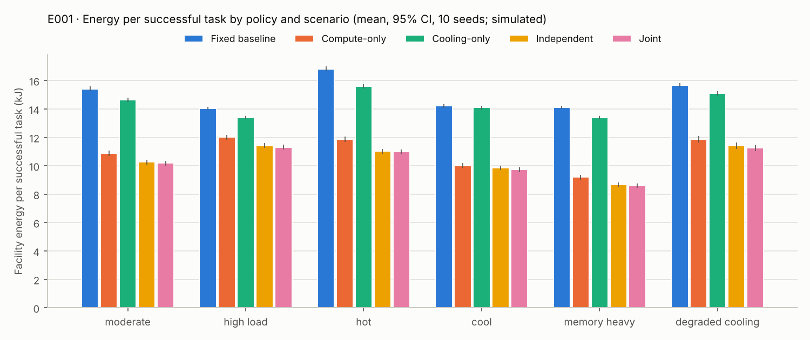
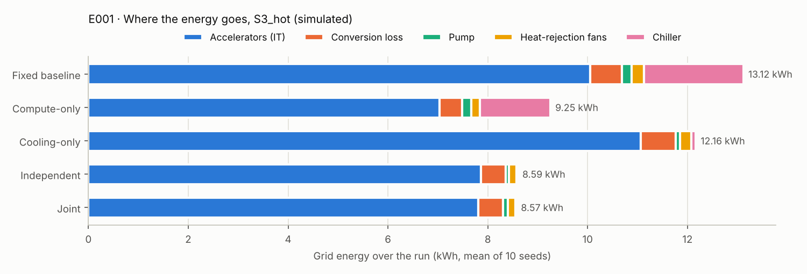
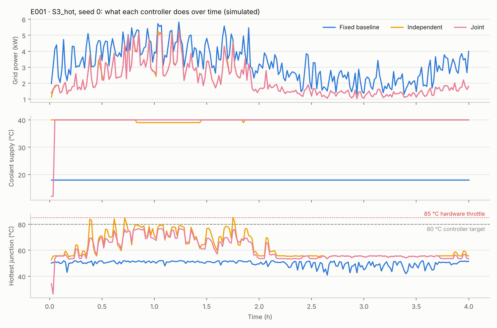
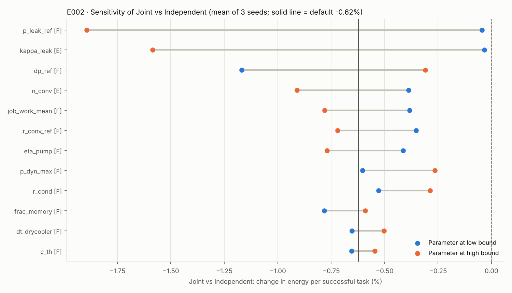
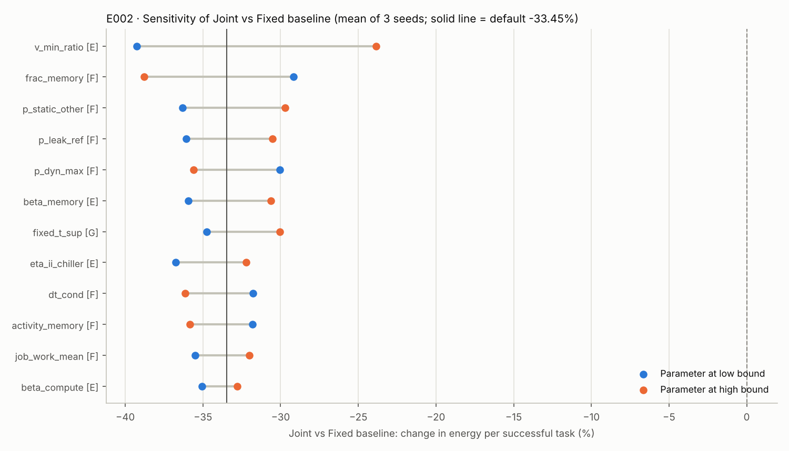
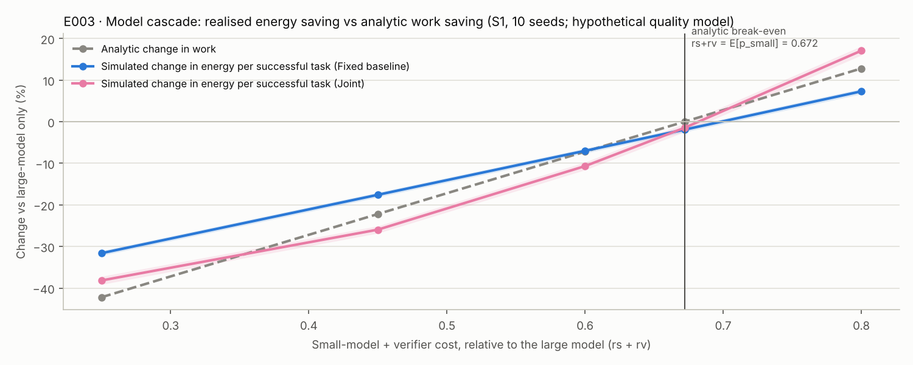
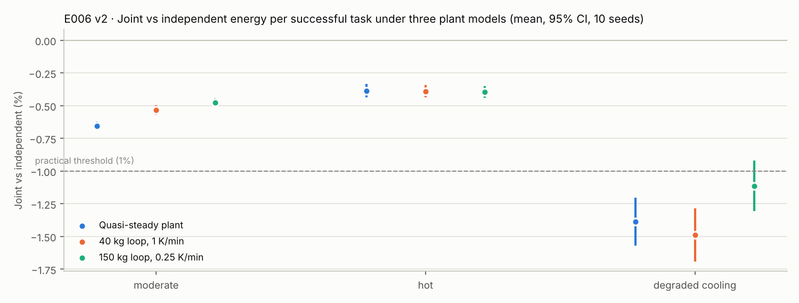
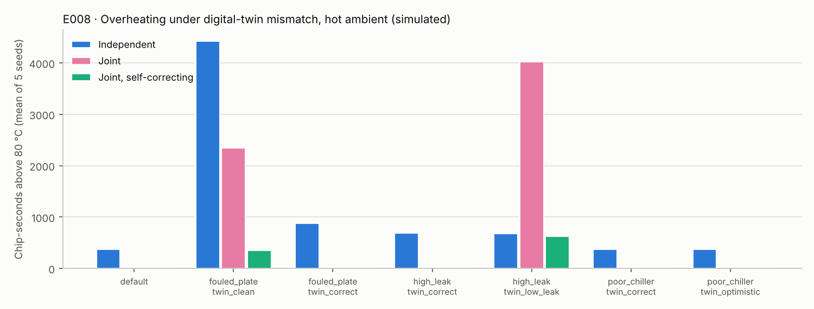
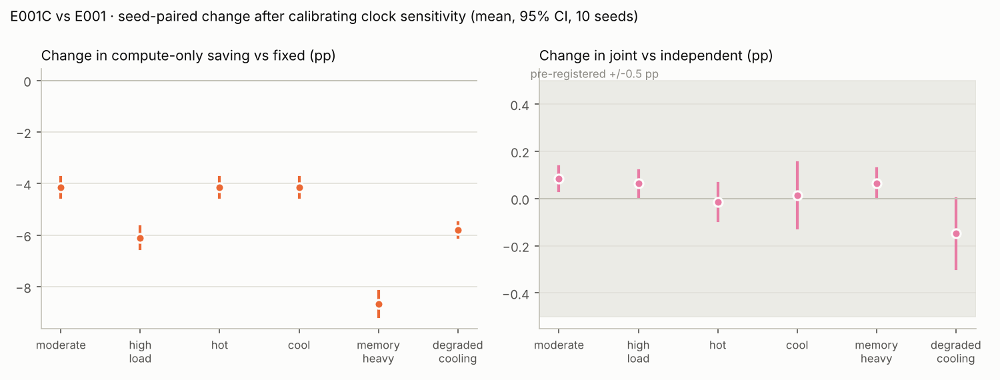

# UEIC · Simulation results (generated)

Generated 2026-10-26T22:17:31+00:00 by `python -m ueic report` from `results/ueic.sqlite`. Code SHA-256 `6d1bdaaf0e701cae…`. Hash-chain check: **OK** (3163 finalised runs verified).

> **Every number on this page is a simulator output** (provenance `simulator_output`) and is conditional on the parameter registry (`04_assumptions_register.md`), most of which is class E/F. E001C uses two parameters measured on a real GPU (M001); every other parameter is still a placeholder. The measurements themselves are reported in `10_calibration_results.md`. Energy boundary: grid → conversion → accelerators + pump + fans + chiller (see `00_problem_statement.md`).

## Pre-registered hypotheses, evaluated mechanically

| Experiment | Verdict | Detail |
|---|---|---|
| E001 H1 | **supported, small** | Joint below independent with CI under zero in 6/6 scenarios; beyond the 1% practical threshold in 2/6. |
| E001 H2 | **energy met, guard failed** | Every optimising policy below fixed on energy per successful task in every scenario; quality guard failed in 18 comparisons (slightly more late tasks). |
| E001C H1 | **supported** | With measured clock sensitivity, joint below independent with CI under zero in 6/6 scenarios; beyond the 1% threshold in 2/6. |
| E001C H2 | **energy met, guard failed** | Every optimising policy below fixed in every scenario; quality guard failed in 18 comparisons. |
| E001C HC1 | **supported** | Change in compute-only's saving vs fixed (calibrated minus E001, percentage points): moderate -4.14, high_load -6.10, hot -4.14, cool -4.14, memory_heavy -8.67, degraded_cooling -5.80; CI below zero in 6/6. |
| E001C HC2 | **supported** | Largest change in S5_memory_heavy (predicted S5_memory_heavy). |
| E001C HC3 | **supported** | Change in joint's advantage over independent (pp): moderate +0.08 [+0.03, +0.13], high_load +0.06 [+0.01, +0.12], hot -0.01 [-0.09, +0.06], cool +0.01 [-0.12, +0.15], memory_heavy +0.06 [+0.00, +0.13], degraded_cooling -0.15 [-0.30, +0.00]; within +/-0.5 pp in 6/6 (need 5). |
| E002 | **partly supported** | Joint never above independent in 50 one-at-a-time variants. Top driver of joint vs independent: p_leak_ref; of joint vs fixed: v_min_ratio; beta_memory ranks 6 (predicted top 2). |
| E003 | **partly supported** | Saves below break-even: yes; costs above it: yes; energy saving smaller than work saving: no; false accepts lower success: yes. |
| E004 | **not met** | Worst change dt 1 s vs 0.5 s: fixed 0.02%, joint 0.52% (criterion < 0.5%). |
| E005 | **partly supported** | Leakage/cold-plate twin errors pushed joint over the 80 °C target in 2/4 cases (S3_hot) and shrank its advantage over independent in 3/4; hardware protection held peak temperature near 85 °C. |
| E006 | **partly supported** | H1 joint < independent under both dynamic plants in all scenarios: yes. H2 joint over target with the slow plant: yes (S6_degraded_cooling). H3 fixed policy unaffected: yes. H4 joint_robust never worse than joint on overheating: no (S6_degraded_cooling/dyn_150kg_0.25Kmin, S6_degraded_cooling/dyn_40kg_1Kmin). |
| E007 | **supported, but suppression not the cause** | Switching cut by a 5% threshold: S1_moderate 16.5%, S3_hot 24.5% (H1 <25%: yes). Worst dt-sensitivity at 2%: S1_moderate 0.39%, S3_hot 0.38%; with no threshold: S1_moderate 0.39%, S3_hot 0.38%. Energy cost of 2%: <= 0.3%. |
| E008 | **partly supported** | Where joint overheated (2 cases) the correction cut chip-seconds over target by 85%, 84% with no throttling (H1: yes). Not confirmed no-worse than independent in S3_hot/high_leak|twin_low_leak (H2: no). Within 0.5% of joint with a correct twin (H3: yes). |

## E004 · Time-step convergence

Experiment `E004-20261026T180548-d4faa6`. Pre-registered criterion: grid energy changes < 0.5% between dt = 0.5 s and 1 s.

| Policy | Seed | dt | Change in grid energy vs dt = 0.5 s |
|---|---|---|---|
| fixed | 0 | dt=0.25 | -0.008% |
| fixed | 0 | dt=1.0 | -0.020% |
| fixed | 0 | dt=2.0 | -0.019% |
| fixed | 1 | dt=0.25 | +0.002% |
| fixed | 1 | dt=1.0 | -0.004% |
| fixed | 1 | dt=2.0 | -0.018% |
| joint | 0 | dt=0.25 | +0.375% |
| joint | 0 | dt=1.0 | +0.345% |
| joint | 0 | dt=2.0 | +0.596% |
| joint | 1 | dt=0.25 | -0.064% |
| joint | 1 | dt=1.0 | +0.524% |
| joint | 1 | dt=2.0 | +1.510% |

Worst |change| at dt = 1 s: fixed 0.020%, joint 0.524%. **Criterion NOT met.**

## E001 · Policy benchmark

Experiment `E001-20261026T181652-ada586`: 300 runs, 0 failed. 6 scenarios × 5 policies × 10 paired seeds.

### Energy per successful task (kJ, mean [95% CI])

| Scenario | Fixed baseline | Compute-only | Cooling-only | Independent | Joint |
|---|---|---|---|---|---|
| S1_moderate | 15.42 [15.27, 15.58] | 10.88 [10.70, 11.06] | 14.66 [14.51, 14.81] | 10.26 [10.09, 10.43] | 10.19 [10.02, 10.36] |
| S2_high_load | 14.05 [13.95, 14.14] | 12.02 [11.85, 12.19] | 13.41 [13.31, 13.50] | 11.43 [11.26, 11.60] | 11.31 [11.15, 11.47] |
| S3_hot | 16.82 [16.65, 16.99] | 11.86 [11.67, 12.06] | 15.59 [15.44, 15.75] | 11.02 [10.84, 11.20] | 10.98 [10.80, 11.16] |
| S4_cool | 14.21 [14.07, 14.36] | 10.02 [9.86, 10.19] | 14.10 [13.96, 14.24] | 9.86 [9.70, 10.02] | 9.73 [9.56, 9.89] |
| S5_memory_heavy | 14.10 [13.98, 14.23] | 9.20 [9.03, 9.36] | 13.39 [13.27, 13.50] | 8.66 [8.50, 8.82] | 8.61 [8.45, 8.77] |
| S6_degraded_cooling | 15.69 [15.54, 15.84] | 11.88 [11.65, 12.10] | 15.10 [14.96, 15.24] | 11.41 [11.19, 11.63] | 11.25 [11.04, 11.47] |

### Paired comparisons of energy per successful task

Practical threshold ±1%. Δ SLO = change in late-or-unfinished tasks per run (mean); Δ throttled = change in chip-seconds under hardware throttling.

| Scenario | Comparison | Change [95% CI] | Verdict | Δ SLO | Δ success rate | Δ throttled |
|---|---|---|---|---|---|---|
| S1_moderate | Compute-only vs Fixed baseline | -29.48% [-30.11%, -28.86%] | meaningful reduction (CI beyond threshold) | +0.2 | -0.007 pp | +0 |
| S2_high_load | Compute-only vs Fixed baseline | -14.44% [-15.46%, -13.42%] | meaningful reduction (CI beyond threshold) | +1.8 | -0.041 pp | +0 |
| S3_hot | Compute-only vs Fixed baseline | -29.47% [-30.10%, -28.85%] | meaningful reduction (CI beyond threshold) | +0.2 | -0.007 pp | +0 |
| S4_cool | Compute-only vs Fixed baseline | -29.49% [-30.11%, -28.86%] | meaningful reduction (CI beyond threshold) | +0.2 | -0.007 pp | +0 |
| S5_memory_heavy | Compute-only vs Fixed baseline | -34.78% [-35.57%, -34.00%] | meaningful reduction (CI beyond threshold) | +0.2 | -0.007 pp | +0 |
| S6_degraded_cooling | Compute-only vs Fixed baseline | -24.30% [-25.26%, -23.35%] | meaningful reduction (CI beyond threshold) | +0.5 | -0.013 pp | +0 |
| S1_moderate | Cooling-only vs Fixed baseline | -4.97% [-4.99%, -4.95%] | meaningful reduction (CI beyond threshold) | +0.0 | +0.000 pp | +0 |
| S2_high_load | Cooling-only vs Fixed baseline | -4.57% [-4.59%, -4.55%] | meaningful reduction (CI beyond threshold) | +0.0 | +0.000 pp | +0 |
| S3_hot | Cooling-only vs Fixed baseline | -7.28% [-7.30%, -7.26%] | meaningful reduction (CI beyond threshold) | +0.0 | +0.000 pp | +0 |
| S4_cool | Cooling-only vs Fixed baseline | -0.82% [-0.91%, -0.73%] | detectable reduction, not confirmed >= threshold | +0.0 | +0.000 pp | +0 |
| S5_memory_heavy | Cooling-only vs Fixed baseline | -5.09% [-5.11%, -5.07%] | meaningful reduction (CI beyond threshold) | +0.0 | +0.000 pp | +0 |
| S6_degraded_cooling | Cooling-only vs Fixed baseline | -3.77% [-3.82%, -3.72%] | meaningful reduction (CI beyond threshold) | +0.0 | +0.000 pp | +0 |
| S1_moderate | Independent vs Fixed baseline | -33.49% [-34.09%, -32.88%] | meaningful reduction (CI beyond threshold) | +0.2 | -0.007 pp | +0 |
| S2_high_load | Independent vs Fixed baseline | -18.64% [-19.64%, -17.63%] | meaningful reduction (CI beyond threshold) | +1.8 | -0.041 pp | +0 |
| S3_hot | Independent vs Fixed baseline | -34.50% [-35.06%, -33.94%] | meaningful reduction (CI beyond threshold) | +0.2 | -0.007 pp | +10 |
| S4_cool | Independent vs Fixed baseline | -30.63% [-31.23%, -30.02%] | meaningful reduction (CI beyond threshold) | +0.2 | -0.007 pp | +0 |
| S5_memory_heavy | Independent vs Fixed baseline | -38.60% [-39.37%, -37.83%] | meaningful reduction (CI beyond threshold) | +0.2 | -0.007 pp | +0 |
| S6_degraded_cooling | Independent vs Fixed baseline | -27.28% [-28.23%, -26.34%] | meaningful reduction (CI beyond threshold) | +0.5 | -0.013 pp | +188 |
| S1_moderate | Joint vs Fixed baseline | -33.92% [-34.53%, -33.31%] | meaningful reduction (CI beyond threshold) | +0.2 | -0.007 pp | +0 |
| S2_high_load | Joint vs Fixed baseline | -19.48% [-20.44%, -18.52%] | meaningful reduction (CI beyond threshold) | +1.8 | -0.041 pp | +0 |
| S3_hot | Joint vs Fixed baseline | -34.72% [-35.28%, -34.15%] | meaningful reduction (CI beyond threshold) | +0.2 | -0.007 pp | +0 |
| S4_cool | Joint vs Fixed baseline | -31.57% [-32.22%, -30.91%] | meaningful reduction (CI beyond threshold) | +0.2 | -0.007 pp | +0 |
| S5_memory_heavy | Joint vs Fixed baseline | -38.96% [-39.72%, -38.20%] | meaningful reduction (CI beyond threshold) | +0.2 | -0.007 pp | +0 |
| S6_degraded_cooling | Joint vs Fixed baseline | -28.27% [-29.22%, -27.33%] | meaningful reduction (CI beyond threshold) | +0.5 | -0.013 pp | +0 |
| S1_moderate | Joint vs Independent | -0.65% [-0.68%, -0.63%] | detectable reduction, not confirmed >= threshold | +0.0 | +0.000 pp | +0 |
| S2_high_load | Joint vs Independent | -1.04% [-1.11%, -0.97%] | detectable reduction, not confirmed >= threshold | +0.0 | +0.000 pp | +0 |
| S3_hot | Joint vs Independent | -0.33% [-0.37%, -0.29%] | detectable reduction, not confirmed >= threshold | +0.0 | +0.000 pp | -10 |
| S4_cool | Joint vs Independent | -1.36% [-1.49%, -1.22%] | meaningful reduction (CI beyond threshold) | +0.0 | +0.000 pp | +0 |
| S5_memory_heavy | Joint vs Independent | -0.58% [-0.65%, -0.51%] | detectable reduction, not confirmed >= threshold | +0.0 | +0.000 pp | +0 |
| S6_degraded_cooling | Joint vs Independent | -1.36% [-1.50%, -1.22%] | meaningful reduction (CI beyond threshold) | +0.0 | +0.000 pp | -188 |
| S1_moderate | Joint vs Compute-only | -6.30% [-6.34%, -6.26%] | meaningful reduction (CI beyond threshold) | +0.0 | +0.000 pp | +0 |
| S2_high_load | Joint vs Compute-only | -5.89% [-5.94%, -5.84%] | meaningful reduction (CI beyond threshold) | +0.0 | +0.000 pp | +0 |
| S3_hot | Joint vs Compute-only | -7.43% [-7.45%, -7.41%] | meaningful reduction (CI beyond threshold) | +0.0 | +0.000 pp | +0 |
| S4_cool | Joint vs Compute-only | -2.95% [-3.03%, -2.88%] | meaningful reduction (CI beyond threshold) | +0.0 | +0.000 pp | +0 |
| S5_memory_heavy | Joint vs Compute-only | -6.40% [-6.45%, -6.35%] | meaningful reduction (CI beyond threshold) | +0.0 | +0.000 pp | +0 |
| S6_degraded_cooling | Joint vs Compute-only | -5.25% [-5.33%, -5.16%] | meaningful reduction (CI beyond threshold) | +0.0 | +0.000 pp | +0 |
| S1_moderate | Joint vs Cooling-only | -30.47% [-31.10%, -29.84%] | meaningful reduction (CI beyond threshold) | +0.2 | -0.007 pp | +0 |
| S2_high_load | Joint vs Cooling-only | -15.63% [-16.61%, -14.64%] | meaningful reduction (CI beyond threshold) | +1.8 | -0.041 pp | +0 |
| S3_hot | Joint vs Cooling-only | -29.59% [-30.21%, -28.97%] | meaningful reduction (CI beyond threshold) | +0.2 | -0.007 pp | +0 |
| S4_cool | Joint vs Cooling-only | -31.00% [-31.64%, -30.36%] | meaningful reduction (CI beyond threshold) | +0.2 | -0.007 pp | +0 |
| S5_memory_heavy | Joint vs Cooling-only | -35.68% [-36.47%, -34.90%] | meaningful reduction (CI beyond threshold) | +0.2 | -0.007 pp | +0 |
| S6_degraded_cooling | Joint vs Cooling-only | -25.47% [-26.47%, -24.46%] | meaningful reduction (CI beyond threshold) | +0.5 | -0.013 pp | +0 |
| S1_moderate | Independent vs Compute-only | -5.68% [-5.71%, -5.65%] | meaningful reduction (CI beyond threshold) | +0.0 | +0.000 pp | +0 |
| S2_high_load | Independent vs Compute-only | -4.90% [-4.95%, -4.86%] | meaningful reduction (CI beyond threshold) | +0.0 | +0.000 pp | +0 |
| S3_hot | Independent vs Compute-only | -7.13% [-7.17%, -7.08%] | meaningful reduction (CI beyond threshold) | +0.0 | +0.000 pp | +10 |
| S4_cool | Independent vs Compute-only | -1.62% [-1.71%, -1.52%] | meaningful reduction (CI beyond threshold) | +0.0 | +0.000 pp | +0 |
| S5_memory_heavy | Independent vs Compute-only | -5.85% [-5.91%, -5.79%] | meaningful reduction (CI beyond threshold) | +0.0 | +0.000 pp | +0 |
| S6_degraded_cooling | Independent vs Compute-only | -3.94% [-4.03%, -3.84%] | meaningful reduction (CI beyond threshold) | +0.0 | +0.000 pp | +188 |

### Hypotheses

* **H1** (joint < independent with CI below zero in ≥ 4 of 6 scenarios, guards held): **supported**. CI below zero in 6/6 (S1_moderate, S2_high_load, S3_hot, S4_cool, S5_memory_heavy, S6_degraded_cooling); beyond the 1% practical threshold in 2/6 (S4_cool, S6_degraded_cooling).
* **H2** (every optimising policy below fixed in every scenario): energy criterion **met**; pre-registered quality guard **failed in 18 of 24 comparisons** (SLO violations or success rate slightly worse than fixed; see table). Formally, H2 is therefore **not supported as pre-registered**.

### Thermal and quality guards by policy (means over seeds)

| Scenario | Policy | Success rate | SLO violations | p95 latency (s) | Peak T_j (°C) | chip·s > 80 °C | chip·s throttled | Reusable heat ≥45 °C (kWh) |
|---|---|---|---|---|---|---|---|---|
| S1_moderate | Fixed baseline | 0.9708 | 0.0 | 47.2 | 52.0 | 0 | 0 | 0.00 |
| S1_moderate | Compute-only | 0.9708 | 0.2 | 68.9 | 51.9 | 0 | 0 | 0.00 |
| S1_moderate | Cooling-only | 0.9708 | 0.0 | 47.2 | 71.2 | 0 | 0 | 0.00 |
| S1_moderate | Independent | 0.9708 | 0.2 | 68.9 | 69.4 | 0 | 0 | 0.00 |
| S1_moderate | Joint | 0.9708 | 0.2 | 68.9 | 61.5 | 0 | 0 | 0.00 |
| S2_high_load | Fixed baseline | 0.9685 | 2.8 | 56.0 | 52.0 | 0 | 0 | 0.00 |
| S2_high_load | Compute-only | 0.9681 | 4.6 | 64.9 | 52.0 | 0 | 0 | 0.00 |
| S2_high_load | Cooling-only | 0.9685 | 2.8 | 56.0 | 69.8 | 0 | 0 | 0.00 |
| S2_high_load | Independent | 0.9681 | 4.6 | 64.9 | 69.6 | 0 | 0 | 0.00 |
| S2_high_load | Joint | 0.9681 | 4.6 | 65.0 | 61.8 | 0 | 0 | 0.00 |
| S3_hot | Fixed baseline | 0.9708 | 0.0 | 47.2 | 52.0 | 0 | 0 | 0.00 |
| S3_hot | Compute-only | 0.9708 | 0.2 | 68.9 | 51.9 | 0 | 0 | 0.00 |
| S3_hot | Cooling-only | 0.9708 | 0.0 | 47.2 | 79.8 | 4 | 0 | 6.14 |
| S3_hot | Independent | 0.9708 | 0.2 | 68.9 | 85.1 | 425 | 10 | 3.54 |
| S3_hot | Joint | 0.9708 | 0.2 | 68.9 | 76.6 | 0 | 0 | 2.10 |
| S4_cool | Fixed baseline | 0.9708 | 0.0 | 47.2 | 52.0 | 0 | 0 | 0.00 |
| S4_cool | Compute-only | 0.9708 | 0.2 | 68.9 | 51.9 | 0 | 0 | 0.00 |
| S4_cool | Cooling-only | 0.9708 | 0.0 | 47.2 | 71.2 | 0 | 0 | 0.00 |
| S4_cool | Independent | 0.9708 | 0.2 | 68.9 | 68.0 | 0 | 0 | 0.00 |
| S4_cool | Joint | 0.9708 | 0.2 | 68.9 | 49.4 | 0 | 0 | 0.00 |
| S5_memory_heavy | Fixed baseline | 0.9708 | 0.0 | 47.2 | 51.9 | 0 | 0 | 0.00 |
| S5_memory_heavy | Compute-only | 0.9708 | 0.2 | 63.3 | 51.8 | 0 | 0 | 0.00 |
| S5_memory_heavy | Cooling-only | 0.9708 | 0.0 | 47.2 | 70.2 | 0 | 0 | 0.00 |
| S5_memory_heavy | Independent | 0.9708 | 0.2 | 63.3 | 69.3 | 0 | 0 | 0.00 |
| S5_memory_heavy | Joint | 0.9708 | 0.2 | 63.4 | 62.3 | 0 | 0 | 0.00 |
| S6_degraded_cooling | Fixed baseline | 0.9705 | 0.6 | 51.3 | 69.7 | 0 | 0 | 0.00 |
| S6_degraded_cooling | Compute-only | 0.9704 | 1.1 | 67.0 | 69.6 | 0 | 0 | 0.00 |
| S6_degraded_cooling | Cooling-only | 0.9705 | 0.6 | 51.3 | 80.0 | 4 | 0 | 0.00 |
| S6_degraded_cooling | Independent | 0.9704 | 1.1 | 67.1 | 85.5 | 1240 | 188 | 0.00 |
| S6_degraded_cooling | Joint | 0.9704 | 1.1 | 67.1 | 78.9 | 0 | 0 | 0.00 |

### Energy breakdown (kWh per run, means)

| Scenario | Policy | Grid | IT | Conversion | Pump | Fans | Chiller | Grid/IT |
|---|---|---|---|---|---|---|---|---|
| S1_moderate | Fixed baseline | 12.031 | 10.050 | 0.641 | 0.192 | 0.223 | 0.924 | 1.197 |
| S1_moderate | Compute-only | 8.485 | 7.033 | 0.449 | 0.193 | 0.158 | 0.653 | 1.206 |
| S1_moderate | Cooling-only | 11.433 | 10.523 | 0.672 | 0.028 | 0.211 | 0.000 | 1.086 |
| S1_moderate | Independent | 8.003 | 7.358 | 0.470 | 0.028 | 0.148 | 0.000 | 1.088 |
| S1_moderate | Joint | 7.950 | 7.274 | 0.464 | 0.065 | 0.147 | 0.000 | 1.093 |
| S2_high_load | Fixed baseline | 16.396 | 13.762 | 0.878 | 0.193 | 0.304 | 1.259 | 1.191 |
| S2_high_load | Compute-only | 14.026 | 11.745 | 0.750 | 0.193 | 0.260 | 1.078 | 1.194 |
| S2_high_load | Cooling-only | 15.647 | 14.411 | 0.920 | 0.028 | 0.289 | 0.000 | 1.086 |
| S2_high_load | Independent | 13.338 | 12.280 | 0.784 | 0.028 | 0.246 | 0.000 | 1.086 |
| S2_high_load | Joint | 13.200 | 12.050 | 0.769 | 0.137 | 0.244 | 0.000 | 1.095 |
| S3_hot | Fixed baseline | 13.119 | 10.050 | 0.641 | 0.192 | 0.245 | 1.991 | 1.305 |
| S3_hot | Compute-only | 9.253 | 7.033 | 0.449 | 0.193 | 0.173 | 1.406 | 1.316 |
| S3_hot | Cooling-only | 12.164 | 11.061 | 0.706 | 0.086 | 0.224 | 0.086 | 1.100 |
| S3_hot | Independent | 8.593 | 7.863 | 0.502 | 0.054 | 0.158 | 0.016 | 1.093 |
| S3_hot | Joint | 8.565 | 7.809 | 0.498 | 0.092 | 0.158 | 0.008 | 1.097 |
| S4_cool | Fixed baseline | 11.088 | 10.050 | 0.641 | 0.192 | 0.205 | 0.000 | 1.103 |
| S4_cool | Compute-only | 7.819 | 7.033 | 0.449 | 0.193 | 0.145 | 0.000 | 1.112 |
| S4_cool | Cooling-only | 10.997 | 10.120 | 0.646 | 0.028 | 0.203 | 0.000 | 1.087 |
| S4_cool | Independent | 7.692 | 7.071 | 0.451 | 0.028 | 0.143 | 0.000 | 1.088 |
| S4_cool | Joint | 7.588 | 6.950 | 0.444 | 0.054 | 0.140 | 0.000 | 1.092 |
| S5_memory_heavy | Fixed baseline | 11.003 | 9.175 | 0.586 | 0.192 | 0.204 | 0.846 | 1.199 |
| S5_memory_heavy | Compute-only | 7.176 | 5.920 | 0.378 | 0.193 | 0.133 | 0.552 | 1.212 |
| S5_memory_heavy | Cooling-only | 10.443 | 9.609 | 0.613 | 0.028 | 0.193 | 0.000 | 1.087 |
| S5_memory_heavy | Independent | 6.757 | 6.208 | 0.396 | 0.028 | 0.125 | 0.000 | 1.088 |
| S5_memory_heavy | Joint | 6.717 | 6.148 | 0.392 | 0.053 | 0.124 | 0.000 | 1.093 |
| S6_degraded_cooling | Fixed baseline | 15.935 | 12.747 | 0.814 | 0.192 | 0.296 | 1.886 | 1.250 |
| S6_degraded_cooling | Compute-only | 12.063 | 9.604 | 0.613 | 0.193 | 0.225 | 1.428 | 1.256 |
| S6_degraded_cooling | Cooling-only | 15.335 | 13.308 | 0.849 | 0.589 | 0.284 | 0.304 | 1.152 |
| S6_degraded_cooling | Independent | 11.588 | 10.205 | 0.651 | 0.305 | 0.214 | 0.213 | 1.136 |
| S6_degraded_cooling | Joint | 11.430 | 10.211 | 0.652 | 0.253 | 0.211 | 0.103 | 1.119 |

Controller overhead (measured wall-clock on the simulation host, not modelled energy): joint 0.99 ms per decision, independent 0.22 ms.

## E002 · One-at-a-time sensitivity

Experiment `E002-20261026T181319-d3c503`: 459 runs, 0 failed. S1, 2 h window, 3 seeds per cell (CIs are wide; use for ranking).

### Joint vs Independent (default -0.62%)

| Rank | Parameter | Class | Range | At low | At high | Swing |
|---|---|---|---|---|---|---|
| 1 | `p_leak_ref` | F | 30 – 180 W | -0.04% | -1.89% | 1.85 pp |
| 2 | `kappa_leak` | E | 0.005 – 0.04 1/K | -0.03% | -1.58% | 1.55 pp |
| 3 | `dp_ref` | F | 50000 – 300000 Pa | -1.17% | -0.31% | 0.86 pp |
| 4 | `n_conv` | E | 0.33 – 0.8 - | -0.39% | -0.91% | 0.52 pp |
| 5 | `job_work_mean` | F | 5 – 120 s | -0.38% | -0.78% | 0.40 pp |
| 6 | `r_conv_ref` | F | 0.008 – 0.03 K/W | -0.35% | -0.72% | 0.37 pp |
| 7 | `eta_pump` | F | 0.3 – 0.7 - | -0.41% | -0.77% | 0.36 pp |
| 8 | `p_dyn_max` | F | 300 – 700 W | -0.60% | -0.27% | 0.34 pp |
| 9 | `r_cond` | F | 0.02 – 0.06 K/W | -0.53% | -0.29% | 0.24 pp |
| 10 | `frac_memory` | F | 0.1 – 0.8 - | -0.78% | -0.59% | 0.19 pp |
| 11 | `dt_drycooler` | F | 3 – 10 K | -0.65% | -0.50% | 0.15 pp |
| 12 | `c_th` | F | 100 – 1000 J/K | -0.65% | -0.55% | 0.11 pp |
| 13 | `activity_memory` | F | 0.5 – 1 - | -0.71% | -0.78% | 0.08 pp |
| 14 | `beta_compute` | E | 0.85 – 1 - | -0.66% | -0.73% | 0.07 pp |
| 15 | `idle_dyn_frac` | F | 0 – 0.15 - | -0.65% | -0.58% | 0.07 pp |

### Joint vs Fixed baseline (default -33.45%)

| Rank | Parameter | Class | Range | At low | At high | Swing |
|---|---|---|---|---|---|---|
| 1 | `v_min_ratio` | E | 0.6 – 0.85 - | -39.26% | -23.87% | 15.39 pp |
| 2 | `frac_memory` | F | 0.1 – 0.8 - | -29.18% | -38.80% | 9.63 pp |
| 3 | `p_static_other` | F | 20 – 100 W | -36.30% | -29.72% | 6.58 pp |
| 4 | `p_leak_ref` | F | 30 – 180 W | -36.07% | -30.51% | 5.56 pp |
| 5 | `p_dyn_max` | F | 300 – 700 W | -30.04% | -35.59% | 5.55 pp |
| 6 | `beta_memory` | E | 0.15 – 0.6 - | -35.94% | -30.63% | 5.31 pp |
| 7 | `fixed_t_sup` | G | 12 – 27 degC | -34.75% | -30.05% | 4.70 pp |
| 8 | `eta_ii_chiller` | E | 0.3 – 0.65 - | -36.76% | -32.20% | 4.55 pp |
| 9 | `dt_cond` | F | 4 – 15 K | -31.78% | -36.15% | 4.37 pp |
| 10 | `activity_memory` | F | 0.5 – 1 - | -31.80% | -35.83% | 4.03 pp |
| 11 | `job_work_mean` | F | 5 – 120 s | -35.51% | -32.00% | 3.51 pp |
| 12 | `beta_compute` | E | 0.85 – 1 - | -35.06% | -32.78% | 2.28 pp |
| 13 | `dt_evap` | F | 1 – 6 K | -32.61% | -34.70% | 2.09 pp |
| 14 | `dt_drycooler` | F | 3 – 10 K | -33.78% | -31.92% | 1.86 pp |
| 15 | `dp_ref` | F | 50000 – 300000 Pa | -33.20% | -34.19% | 0.98 pp |

Variants where joint used **more** energy than independent (mean): none. With CI entirely above zero: none.

Variants in which any policy triggered hardware throttling: p_dyn_max=high, r_cond=high.

## E003 · Model-routing cascade

Experiment `E003-20261026T180946-28dd48`: 140 runs, 0 failed. **Quality model is a hypothetical placeholder (class F)**; the transferable results are the break-even condition and the work-vs-energy gap.

| Variant | Policy | rs+rv | Analytic Δ work | Simulated Δ work [CI] | Δ energy per success [CI] | Verdict | Δ success rate | Δ p95 latency |
|---|---|---|---|---|---|---|---|---|
| rs+rv=0.25 | Fixed baseline | 0.25 | -42.2% | -42.2% [-42.9%, -41.6%] | -31.6% [-32.2%, -31.0%] | meaningful reduction (CI beyond threshold) | +1.89 pp | -16.1% |
| rs+rv=0.25 | Joint | 0.25 | -42.2% | -42.2% [-42.9%, -41.6%] | -38.2% [-39.1%, -37.2%] | meaningful reduction (CI beyond threshold) | +1.89 pp | -0.7% |
| rs+rv=0.45 | Fixed baseline | 0.45 | -22.2% | -22.2% [-22.9%, -21.6%] | -17.6% [-18.1%, -17.0%] | meaningful reduction (CI beyond threshold) | +1.89 pp | -1.2% |
| rs+rv=0.45 | Joint | 0.45 | -22.2% | -22.2% [-22.9%, -21.6%] | -26.0% [-26.8%, -25.1%] | meaningful reduction (CI beyond threshold) | +1.89 pp | +10.1% |
| rs+rv=0.60 | Fixed baseline | 0.60 | -7.2% | -7.2% [-7.9%, -6.6%] | -7.0% [-7.6%, -6.4%] | meaningful reduction (CI beyond threshold) | +1.89 pp | +12.4% |
| rs+rv=0.60 | Joint | 0.60 | -7.2% | -7.2% [-7.9%, -6.6%] | -10.7% [-11.6%, -9.7%] | meaningful reduction (CI beyond threshold) | +1.88 pp | +14.9% |
| rs+rv=0.67 | Fixed baseline | 0.67 | +0.0% | -0.0% [-0.7%, +0.6%] | -1.9% [-2.5%, -1.3%] | meaningful reduction (CI beyond threshold) | +1.89 pp | +20.6% |
| rs+rv=0.67 | Joint | 0.67 | +0.0% | -0.0% [-0.7%, +0.6%] | -1.5% [-2.5%, -0.4%] | detectable reduction, not confirmed >= threshold | +1.83 pp | +17.9% |
| rs+rv=0.80 | Fixed baseline | 0.80 | +12.8% | +12.8% [+12.1%, +13.4%] | +7.3% [+6.7%, +7.9%] | meaningful increase (CI beyond threshold) | +1.76 pp | +40.7% |
| rs+rv=0.80 | Joint | 0.80 | +12.8% | +12.8% [+12.1%, +13.4%] | +17.1% [+16.0%, +18.2%] | meaningful increase (CI beyond threshold) | +1.68 pp | +26.0% |
| rs+rv=0.25,false_accept=0.10 | Fixed baseline | 0.25 | -45.5% | -45.2% [-45.8%, -44.6%] | -31.6% [-32.2%, -31.0%] | meaningful reduction (CI beyond threshold) | -1.10 pp | -18.9% |
| rs+rv=0.25,false_accept=0.10 | Joint | 0.25 | -45.5% | -45.2% [-45.8%, -44.6%] | -37.5% [-38.6%, -36.5%] | meaningful reduction (CI beyond threshold) | -1.11 pp | -5.0% |

Analytic break-even with a perfect verifier: rs + rv = E[p_small] = 0.672.

## E005 · Digital-twin mismatch

Experiment `E005-20261026T181138-bbb7db`: 120 runs, 0 failed. 5 seeds.

| Scenario | Truth \| twin | Joint vs independent [CI] | Verdict | Joint chip·s > 80 °C | Independent chip·s > 80 °C | Joint throttled | Independent throttled | Joint peak T | Independent peak T |
|---|---|---|---|---|---|---|---|---|---|
| S1_moderate | fouled_plate|twin_clean | -1.28% [-1.37%, -1.19%] | meaningful reduction (CI beyond threshold) | 0 | 398 | 0 | 0 | 69.3 | 82.4 |
| S1_moderate | fouled_plate|twin_correct | -0.63% [-0.74%, -0.52%] | detectable reduction, not confirmed >= threshold | 0 | 2 | 0 | 0 | 67.1 | 79.2 |
| S1_moderate | high_leak|twin_correct | -2.20% [-2.41%, -1.98%] | meaningful reduction (CI beyond threshold) | 0 | 0 | 0 | 0 | 60.3 | 76.2 |
| S1_moderate | high_leak|twin_low_leak | -1.58% [-1.83%, -1.32%] | meaningful reduction (CI beyond threshold) | 0 | 0 | 0 | 0 | 66.8 | 76.2 |
| S1_moderate | poor_chiller|twin_correct | -0.68% [-0.72%, -0.64%] | detectable reduction, not confirmed >= threshold | 0 | 0 | 0 | 0 | 61.2 | 69.5 |
| S1_moderate | poor_chiller|twin_optimistic | -0.68% [-0.72%, -0.64%] | detectable reduction, not confirmed >= threshold | 0 | 0 | 0 | 0 | 61.2 | 69.5 |
| S3_hot | fouled_plate|twin_clean | -0.34% [-0.48%, -0.20%] | detectable reduction, not confirmed >= threshold | 2341 | 4420 | 9 | 357 | 85.0 | 85.5 |
| S3_hot | fouled_plate|twin_correct | -1.07% [-1.42%, -0.73%] | detectable reduction, not confirmed >= threshold | 0 | 878 | 0 | 120 | 79.3 | 85.4 |
| S3_hot | high_leak|twin_correct | -3.90% [-4.26%, -3.54%] | meaningful reduction (CI beyond threshold) | 0 | 682 | 0 | 89 | 53.7 | 85.4 |
| S3_hot | high_leak|twin_low_leak | +0.70% [+0.31%, +1.09%] | detectable increase, not confirmed >= threshold | 4021 | 680 | 314 | 90 | 85.2 | 85.4 |
| S3_hot | poor_chiller|twin_correct | -0.27% [-0.38%, -0.17%] | detectable reduction, not confirmed >= threshold | 0 | 367 | 0 | 8 | 76.6 | 85.1 |
| S3_hot | poor_chiller|twin_optimistic | -0.30% [-0.37%, -0.22%] | detectable reduction, not confirmed >= threshold | 0 | 369 | 0 | 8 | 76.6 | 85.1 |

## E006 · Dynamic coolant loop (v2)

Experiment `E006-20261026T190821-9afd6b`: 360 runs, 0 failed; supersedes `E006-20261026T184900-8dd0d3` (cold-start confound, see research log). Runs with loop-storage change above 0.5% of grid energy: 13.

| Scenario | Plant | Joint vs independent [95% CI] | Verdict |
|---|---|---|---|
| S1_moderate | quasi_steady | -0.65% [-0.67%, -0.63%] | detectable reduction, not confirmed >= threshold |
| S1_moderate | dyn_40kg_1Kmin | -0.53% [-0.56%, -0.51%] | detectable reduction, not confirmed >= threshold |
| S1_moderate | dyn_150kg_0.25Kmin | -0.47% [-0.50%, -0.45%] | detectable reduction, not confirmed >= threshold |
| S3_hot | quasi_steady | -0.38% [-0.43%, -0.34%] | detectable reduction, not confirmed >= threshold |
| S3_hot | dyn_40kg_1Kmin | -0.39% [-0.43%, -0.35%] | detectable reduction, not confirmed >= threshold |
| S3_hot | dyn_150kg_0.25Kmin | -0.39% [-0.43%, -0.36%] | detectable reduction, not confirmed >= threshold |
| S6_degraded_cooling | quasi_steady | -1.39% [-1.56%, -1.21%] | meaningful reduction (CI beyond threshold) |
| S6_degraded_cooling | dyn_40kg_1Kmin | -1.49% [-1.68%, -1.29%] | meaningful reduction (CI beyond threshold) |
| S6_degraded_cooling | dyn_150kg_0.25Kmin | -1.11% [-1.30%, -0.93%] | detectable reduction, not confirmed >= threshold |

| Scenario | Plant | Policy | chip·s > 80 °C | chip·s throttled | Peak T_j (°C) | Loop storage (% of grid) |
|---|---|---|---|---|---|---|
| S1_moderate | dyn_150kg_0.25Kmin | fixed | 0 | 0 | 52.0 | +0.00% |
| S1_moderate | dyn_150kg_0.25Kmin | independent | 0 | 0 | 69.4 | +0.21% |
| S1_moderate | dyn_150kg_0.25Kmin | joint | 0 | 0 | 61.3 | +0.00% |
| S1_moderate | dyn_150kg_0.25Kmin | joint_robust | 0 | 0 | 61.3 | +0.00% |
| S1_moderate | dyn_40kg_1Kmin | fixed | 0 | 0 | 52.0 | +0.00% |
| S1_moderate | dyn_40kg_1Kmin | independent | 0 | 0 | 69.4 | +0.20% |
| S1_moderate | dyn_40kg_1Kmin | joint | 0 | 0 | 61.3 | +0.00% |
| S1_moderate | dyn_40kg_1Kmin | joint_robust | 0 | 0 | 61.3 | +0.00% |
| S1_moderate | quasi_steady | fixed | 0 | 0 | 52.0 | +0.00% |
| S1_moderate | quasi_steady | independent | 0 | 0 | 69.4 | +0.00% |
| S1_moderate | quasi_steady | joint | 0 | 0 | 61.3 | +0.00% |
| S1_moderate | quasi_steady | joint_robust | 0 | 0 | 61.3 | +0.00% |
| S3_hot | dyn_150kg_0.25Kmin | fixed | 0 | 0 | 52.0 | +0.00% |
| S3_hot | dyn_150kg_0.25Kmin | independent | 415 | 6 | 85.0 | -0.01% |
| S3_hot | dyn_150kg_0.25Kmin | joint | 0 | 0 | 76.6 | -0.00% |
| S3_hot | dyn_150kg_0.25Kmin | joint_robust | 0 | 0 | 76.6 | -0.00% |
| S3_hot | dyn_40kg_1Kmin | fixed | 0 | 0 | 52.0 | +0.00% |
| S3_hot | dyn_40kg_1Kmin | independent | 408 | 6 | 85.1 | -0.00% |
| S3_hot | dyn_40kg_1Kmin | joint | 0 | 0 | 76.6 | -0.00% |
| S3_hot | dyn_40kg_1Kmin | joint_robust | 0 | 0 | 76.6 | -0.00% |
| S3_hot | quasi_steady | fixed | 0 | 0 | 52.0 | +0.00% |
| S3_hot | quasi_steady | independent | 433 | 11 | 85.1 | -0.01% |
| S3_hot | quasi_steady | joint | 0 | 0 | 76.6 | -0.01% |
| S3_hot | quasi_steady | joint_robust | 0 | 0 | 76.6 | -0.01% |
| S6_degraded_cooling | dyn_150kg_0.25Kmin | fixed | 0 | 0 | 69.7 | +0.00% |
| S6_degraded_cooling | dyn_150kg_0.25Kmin | independent | 1256 | 152 | 85.5 | +0.85% |
| S6_degraded_cooling | dyn_150kg_0.25Kmin | joint | 421 | 0 | 81.1 | -0.04% |
| S6_degraded_cooling | dyn_150kg_0.25Kmin | joint_robust | 464 | 0 | 82.4 | -0.04% |
| S6_degraded_cooling | dyn_40kg_1Kmin | fixed | 0 | 0 | 69.7 | +0.00% |
| S6_degraded_cooling | dyn_40kg_1Kmin | independent | 1168 | 139 | 85.5 | -0.27% |
| S6_degraded_cooling | dyn_40kg_1Kmin | joint | 131 | 0 | 80.5 | -0.06% |
| S6_degraded_cooling | dyn_40kg_1Kmin | joint_robust | 176 | 0 | 81.4 | -0.05% |
| S6_degraded_cooling | quasi_steady | fixed | 0 | 0 | 69.7 | +0.00% |
| S6_degraded_cooling | quasi_steady | independent | 1182 | 171 | 85.5 | +0.00% |
| S6_degraded_cooling | quasi_steady | joint | 0 | 0 | 78.9 | +0.00% |
| S6_degraded_cooling | quasi_steady | joint_robust | 0 | 0 | 78.9 | +0.00% |

## E007 · Move suppression

Experiment `E007-20261026T185421-9da2d0`: 140 runs, 0 failed. Joint controller only.

| Scenario | Threshold | dt (s) | Action changes | Clock | Flow | Supply temp | Energy per success (kJ) |
|---|---|---|---|---|---|---|---|
| S1_moderate | 0.5% | 1 | 102.4 | 102.4 | 37.8 | 0.0 | 10.193 |
| S1_moderate | 2.0% | 0.5 | 101.1 | 101.1 | 35.8 | 0.0 | 10.172 |
| S1_moderate | 2.0% | 1 | 101.0 | 101.0 | 37.4 | 0.0 | 10.193 |
| S1_moderate | 5.0% | 0.5 | 88.0 | 88.0 | 34.8 | 0.0 | 10.208 |
| S1_moderate | 5.0% | 1 | 87.0 | 87.0 | 36.8 | 0.0 | 10.235 |
| S1_moderate | 0.0% | 0.5 | 104.3 | 103.1 | 37.0 | 0.0 | 10.171 |
| S1_moderate | 0.0% | 1 | 104.2 | 103.0 | 39.0 | 0.0 | 10.192 |
| S3_hot | 0.5% | 1 | 105.2 | 102.6 | 32.4 | 1.0 | 10.984 |
| S3_hot | 2.0% | 0.5 | 103.3 | 101.1 | 29.9 | 1.0 | 10.963 |
| S3_hot | 2.0% | 1 | 103.6 | 101.0 | 32.2 | 1.0 | 10.987 |
| S3_hot | 5.0% | 0.5 | 89.8 | 87.6 | 28.7 | 1.0 | 11.009 |
| S3_hot | 5.0% | 1 | 89.3 | 86.7 | 31.6 | 1.0 | 11.037 |
| S3_hot | 0.0% | 0.5 | 118.1 | 103.3 | 41.9 | 1.2 | 10.957 |
| S3_hot | 0.0% | 1 | 118.3 | 103.2 | 43.8 | 1.2 | 10.980 |

| Scenario | Threshold | Energy vs no threshold [95% CI] |
|---|---|---|
| S1_moderate | thr=0.005|dt=1.0 | +0.003% [-0.007%, +0.012%] |
| S3_hot | thr=0.005|dt=1.0 | +0.034% [+0.025%, +0.042%] |
| S1_moderate | thr=0.02|dt=1.0 | +0.006% [-0.017%, +0.029%] |
| S3_hot | thr=0.02|dt=1.0 | +0.055% [+0.034%, +0.077%] |
| S1_moderate | thr=0.05|dt=1.0 | +0.416% [+0.116%, +0.715%] |
| S3_hot | thr=0.05|dt=1.0 | +0.517% [+0.207%, +0.827%] |
| S1_moderate | thr=0.0|dt=1.0 | +0.000% [+0.000%, +0.000%] |
| S3_hot | thr=0.0|dt=1.0 | +0.000% [+0.000%, +0.000%] |

| Scenario | Threshold | Worst per-seed change dt 1 s vs 0.5 s | Mean | Seeds |
|---|---|---|---|---|
| S1_moderate | 0.0% | 0.388% | 0.215% | 10 |
| S3_hot | 0.0% | 0.382% | 0.219% | 10 |
| S1_moderate | 2.0% | 0.387% | 0.211% | 10 |
| S3_hot | 2.0% | 0.382% | 0.217% | 10 |
| S1_moderate | 5.0% | 0.524% | 0.267% | 10 |
| S3_hot | 5.0% | 0.500% | 0.263% | 10 |

## E008 · Self-correcting joint control under twin mismatch

Experiment `E008-20261026T185711-ac8eb3`: 210 runs, 0 failed. 5 seeds.

| Scenario | Truth \| twin | Self-correcting vs independent | vs joint | Joint vs independent | chip·s > 80 °C (I / J / J-sc) | throttled (I / J / J-sc) |
|---|---|---|---|---|---|---|
| S1_moderate | default | -0.68% [-0.72%, -0.64%] | +0.00% [+0.00%, +0.00%] | -0.68% [-0.72%, -0.64%] | 0 / 0 / 0 | 0 / 0 / 0 |
| S1_moderate | fouled_plate|twin_clean | -1.28% [-1.37%, -1.19%] | +0.00% [+0.00%, +0.00%] | -1.28% [-1.37%, -1.19%] | 398 / 0 / 0 | 0 / 0 / 0 |
| S1_moderate | fouled_plate|twin_correct | -0.63% [-0.74%, -0.52%] | +0.00% [+0.00%, +0.00%] | -0.63% [-0.74%, -0.52%] | 2 / 0 / 0 | 0 / 0 / 0 |
| S1_moderate | high_leak|twin_correct | -2.20% [-2.41%, -1.98%] | +0.00% [+0.00%, +0.00%] | -2.20% [-2.41%, -1.98%] | 0 / 0 / 0 | 0 / 0 / 0 |
| S1_moderate | high_leak|twin_low_leak | -1.58% [-1.83%, -1.32%] | +0.00% [+0.00%, +0.00%] | -1.58% [-1.83%, -1.32%] | 0 / 0 / 0 | 0 / 0 / 0 |
| S1_moderate | poor_chiller|twin_correct | -0.68% [-0.72%, -0.64%] | +0.00% [+0.00%, +0.00%] | -0.68% [-0.72%, -0.64%] | 0 / 0 / 0 | 0 / 0 / 0 |
| S1_moderate | poor_chiller|twin_optimistic | -0.68% [-0.72%, -0.64%] | +0.00% [+0.00%, +0.00%] | -0.68% [-0.72%, -0.64%] | 0 / 0 / 0 | 0 / 0 / 0 |
| S3_hot | default | -0.33% [-0.40%, -0.27%] | +0.00% [+0.00%, +0.01%] | -0.33% [-0.40%, -0.27%] | 369 / 0 / 0 | 8 / 0 / 0 |
| S3_hot | fouled_plate|twin_clean | -0.19% [-0.38%, -0.01%] | +0.14% [+0.06%, +0.22%] | -0.34% [-0.48%, -0.20%] | 4420 / 2341 / 353 | 357 / 9 / 0 |
| S3_hot | fouled_plate|twin_correct | -1.01% [-1.37%, -0.66%] | +0.06% [+0.01%, +0.11%] | -1.07% [-1.42%, -0.73%] | 878 / 0 / 0 | 120 / 0 / 0 |
| S3_hot | high_leak|twin_correct | -3.90% [-4.26%, -3.54%] | +0.00% [+0.00%, +0.00%] | -3.90% [-4.26%, -3.54%] | 682 / 0 / 0 | 89 / 0 / 0 |
| S3_hot | high_leak|twin_low_leak | +0.07% [-0.17%, +0.31%] | -0.63% [-0.79%, -0.46%] | +0.70% [+0.31%, +1.09%] | 680 / 4021 / 624 | 90 / 314 / 0 |
| S3_hot | poor_chiller|twin_correct | -0.27% [-0.38%, -0.17%] | +0.00% [+0.00%, +0.01%] | -0.27% [-0.38%, -0.17%] | 367 / 0 / 0 | 8 / 0 / 0 |
| S3_hot | poor_chiller|twin_optimistic | -0.29% [-0.37%, -0.22%] | +0.00% [+0.00%, +0.01%] | -0.30% [-0.37%, -0.22%] | 369 / 0 / 0 | 8 / 0 / 0 |

## E001C · Policy benchmark with measured clock sensitivity

Experiment `E001C-20261026T213353-ac0b5f`: 300 runs, 0 failed. Same design, seeds and workloads as E001 (`E001-20261026T181652-ada586`), with `beta_compute` = 0.983, `beta_memory` = 0.0 from M001. Changes are seed-paired against E001.

| Scenario | Compute-only vs fixed: E001 | E001C | change (pp, 95% CI) | Joint vs independent: E001 | E001C | change (pp, 95% CI) |
|---|---|---|---|---|---|---|
| S1_moderate | -29.5% | -33.6% | -4.14 [-4.53, -3.76] | -0.65% | -0.57% | +0.08 [+0.03, +0.13] |
| S2_high_load | -14.4% | -20.5% | -6.10 [-6.52, -5.68] | -1.04% | -0.97% | +0.06 [+0.01, +0.12] |
| S3_hot | -29.5% | -33.6% | -4.14 [-4.53, -3.76] | -0.33% | -0.34% | -0.01 [-0.09, +0.06] |
| S4_cool | -29.5% | -33.6% | -4.14 [-4.53, -3.76] | -1.36% | -1.34% | +0.01 [-0.12, +0.15] |
| S5_memory_heavy | -34.8% | -43.4% | -8.67 [-9.16, -8.17] | -0.58% | -0.52% | +0.06 [+0.00, +0.13] |
| S6_degraded_cooling | -24.3% | -30.1% | -5.80 [-6.09, -5.52] | -1.36% | -1.51% | -0.15 [-0.30, +0.00] |

### Energy per successful task in E001C (kJ, mean [95% CI])

| Scenario | Fixed baseline | Compute-only | Cooling-only | Independent | Joint |
|---|---|---|---|---|---|
| S1_moderate | 15.42 [15.27, 15.58] | 10.24 [10.03, 10.45] | 14.66 [14.51, 14.81] | 9.64 [9.44, 9.85] | 9.59 [9.39, 9.79] |
| S2_high_load | 14.05 [13.95, 14.14] | 11.16 [10.97, 11.36] | 13.41 [13.31, 13.50] | 10.60 [10.41, 10.79] | 10.49 [10.31, 10.68] |
| S3_hot | 16.82 [16.65, 16.99] | 11.17 [10.93, 11.40] | 15.59 [15.44, 15.75] | 10.38 [10.17, 10.60] | 10.35 [10.14, 10.56] |
| S4_cool | 14.21 [14.07, 14.36] | 9.44 [9.24, 9.63] | 14.10 [13.96, 14.24] | 9.27 [9.07, 9.46] | 9.14 [8.95, 9.34] |
| S5_memory_heavy | 14.10 [13.98, 14.23] | 7.98 [7.82, 8.14] | 13.39 [13.27, 13.50] | 7.49 [7.34, 7.65] | 7.45 [7.30, 7.60] |
| S6_degraded_cooling | 15.69 [15.54, 15.84] | 10.97 [10.73, 11.20] | 15.10 [14.96, 15.24] | 10.53 [10.30, 10.77] | 10.37 [10.14, 10.60] |

## Experiment register (including superseded and failed)

| Id | Status | Runs | Title |
|---|---|---|---|
| `E004-20261026T180014-01ec84` | completed | {"failed": 0, "runs": 16} | Numerical convergence in the time step |
| `E001-20261026T180020-09ee19` | completed | {"failed": 0, "runs": 300} | Policy benchmark: fixed vs compute-only vs cooling-only vs independent vs joint |
| `E003-20261026T180404-1c3acc` | failed | {"aborted": "stopped: plant bug (negative chiller work) found in E001 v1 analysis; rerun with fixed code", "unfinished_runs": 82} | Model-routing cascade with verification: realised energy vs analytic work savings |
| `E004-20261026T180548-d4faa6` | completed | {"failed": 0, "runs": 16} | Numerical convergence in the time step |
| `E001-20261026T180555-756536` | completed | {"failed": 0, "runs": 300} | Policy benchmark: fixed vs compute-only vs cooling-only vs independent vs joint |
| `E003-20261026T180946-28dd48` | completed | {"failed": 0, "runs": 140} | Model-routing cascade with verification: realised energy vs analytic work savings |
| `E005-20261026T181138-bbb7db` | completed | {"failed": 0, "runs": 120} | Robustness of model-based control to digital-twin mismatch |
| `E002-20261026T181319-d3c503` | completed | {"failed": 0, "runs": 459} | One-at-a-time sensitivity of policy comparisons to uncertain assumptions |
| `E001-20261026T181652-ada586` | completed | {"failed": 0, "runs": 300} | Policy benchmark: fixed vs compute-only vs cooling-only vs independent vs joint |
| `E006-20261026T184900-8dd0d3` | completed | {"failed": 0, "runs": 360} | Joint control under a dynamic coolant loop (thermal mass + setpoint ramp limits) |
| `E007-20261026T185421-9da2d0` | completed | {"failed": 0, "runs": 140} | Move suppression for the joint controller: switching, energy cost, and time-step sensitivity |
| `E008-20261026T185711-ac8eb3` | completed | {"failed": 0, "runs": 210} | Self-correcting joint control under digital-twin mismatch |
| `E006-20261026T190821-9afd6b` | completed | {"failed": 0, "runs": 360} | Joint control under a dynamic coolant loop (thermal mass + setpoint ramp limits) |
| `M001-20261026T213241-115dce` | completed | {"failed": 0, "measurement": true, "runs": 1} | GPU calibration measurement (NVIDIA GeForce RTX 5070) |
| `E001C-20261026T213353-ac0b5f` | completed | {"failed": 0, "runs": 300} | Policy benchmark with measured clock sensitivity (M001: RTX 5070) |
| `M002-20261026T221416-c4ad2d` | completed | {"failed": 0, "measurement": true, "runs": 1} | Leakage warm-up, attempt 2 (RTX 5070, 2347 MHz, automatic fan) |
